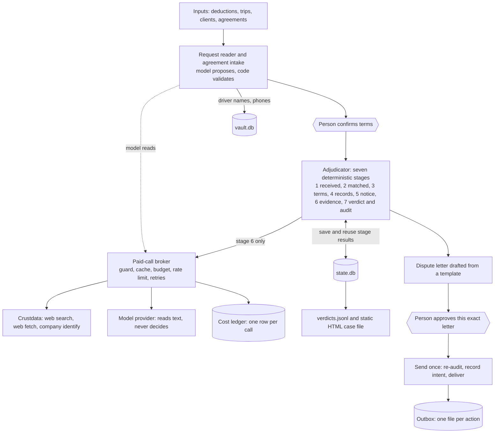

# Penalty-Deduction Recovery (`pdr`)

A service that checks every penalty a client deducts from a 3PL's payment against the client's own agreement, the
3PL's records and dated public evidence. It says for each deduction whether it is **valid**, **disputable** (with the
amount to recover) or **cannot verify** (naming what is missing), and sends each approved dispute exactly once.

Built at ContextCon 05 (22 Nov 2026). Design: [`docs/architecture.md`](docs/architecture.md); context documents in
`docs/context/`.

Contents: [The service](#the-service) · [What it does now](#what-it-does-now) ·
[What it could do in the future](#what-it-could-do-in-the-future) · [The future of this service](#the-future-of-this-service) ·
[How to run it](#how-to-run-it) · [How it's built](#how-its-built) · [Its sources and checks](#its-sources-and-checks) ·
[The approaches we tried](#the-approaches-we-tried)

## The service

A client (a manufacturer or retailer) deducts penalties from the money it owes its logistics provider (a 3PL): late
delivery, short placement, missed slots. Many of these deductions are wrong under the client's own agreement: the rate
is applied to the wrong base, the cap is exceeded, or a force-majeure clause excuses the delay. `pdr` checks each
deduction against the agreement, the 3PL's records and dated public reports, and drafts a dispute letter for the ones
that can be recovered.

It is for the 3PL's billing and finance team. Today that work is done by hand, case by case, so most deductions are
written off; large ones go to lawyers or arbitration.

### The six things the brief asks for

| Field | Answer |
| --- | --- |
| **Job** | Decide, for each penalty a client deducts from a 3PL's payment, whether the client's own agreement and the evidence allow it. Then recover what they don't. |
| **Who pays for it today** | In India, the 3PL's billing staff spend hours per case, so most deductions are written off; lawyers and arbitration follow for large sums (TCI fought a Rs 62.8 lakh deduction for 12 years and lost for want of records made at the time). In the US, suppliers pay recovery firms a share of what they recover. Buyer here: the 3PL's finance controller (see [`docs/finance.md`](docs/finance.md)). |
| **Input** | (1) The client's payment advice, deduction note, spreadsheet, PDF or pasted email (K4). (2) The 3PL's trip records: dispatch, reporting, loading, delivery times, POD, gate logs, GPS halts, notices sent, ops notes (K3). (3) The client's agreement set: master, schedules, amendments, referenced general terms (K2), with terms confirmed by a person. (4) Client list and lanes (K1). Formats: [`docs/input_format.md`](docs/input_format.md). |
| **Finished result** | Per deduction: one verdict line (K5, `out/verdicts.jsonl`) citing clause, page and verbatim text, record rows, and dated sources with passage, publication date and retrieval time; the amount to recover; an evidence pack in a static case file (`out/index.html`). Per approved dispute: one letter in the K7 outbox, sent exactly once. Per paid call: one cost-ledger row. |
| **Pass mark** | On the hidden set: zero wrong "disputable" verdicts; every other verdict correct or an honest "cannot verify" that names what is missing; no dispute without a source that states the event on that route and date; no dispute sent twice, including after a kill; no paid call repeated after a restart. |
| **Data sources called** | Listed in full below. |

## What it does now

Everything in this section works on `main` today and was checked from a fresh clone on 22 Nov 2026 (offline, with
recorded responses):

| Part | State | How it was checked |
| --- | --- | --- |
| Verdict engine (match, terms, records, notice, evidence, penalty recompute, combine) | works; fails closed (a missing check module gives `cannot_verify`, never `valid`) | `tests/test_cases.py`, unit tests |
| The PRD test cases as folders (1-23, 7b, 12a-12d: 27 folders) | all pass through the test loader with recorded Crustdata responses | `python -m pytest -q tests/test_cases.py` |
| `pdr run` on a case folder | reads the folder, writes `out/verdicts.jsonl` (one line per deduction), drafts letters, renders the case file | `scripts/smoke.sh` |
| Re-run and restart | stages are memoised; a second run on the same input recomputes nothing | `scripts/smoke.sh` |
| Approve and send exactly once | a send killed at any crash point, then re-run, leaves exactly one outbox file | `tests/test_kill.py`, `scripts/smoke.sh` |
| Static case file (`out/index.html`, case pages, money page) | works | `pdr report` |
| Cost ledger and economics | one row per call; cost per deduction, by verdict type, break-even fee rate | `pdr ledger`, `pdr economics` |
| Hash-chained audit trail | works | `pdr trail --verify` |
| Citation recheck (auditor can only downgrade) | works | `pdr recheck <key>` |
| Agreement intake, confirm, complete-set | commands work; without a model key, term proposals come only from the deterministic reader; `pdr load-terms` loads confirmed terms | `pdr intake` on `fixtures/terms/` |
| Preflight | works | `pdr doctor` |

Honest limits:

- **No model key was available**, so no model call has been made live. Every model read in tests is a recorded fake.
- **Google redirect links are resolved by a three-step fallback, and it can still miss.** About 80% of Crustdata
  news results are `google.com/goto` links. For each one the service (1) uses the link as is when it already points
  to the publisher, (2) asks for the redirect once with an 8-second limit, (3) fetches the link through Crustdata
  with `human_mode` and cites the address the article page itself declares. If all three fail the result is logged
  as `unresolved_redirect` and never cited. Google gates freshly issued links for the first few minutes, for us and
  for Crustdata alike, so a fast first run may have only direct links to work with; the deduction then comes back
  `cannot_verify`, never a guess. Measurements: `docs/redirect_resolution.md`.
- `pdr run` was run offline on all 27 case folders: none crashed. The 14 cases that need web evidence (1, 2, 3, 7,
  7b, 8, 11, 12a, 15, 17, 19, 21, 22, 23) give `cannot_verify / PROVIDER_FAILED`, because offline the CLI has no
  recorded responses (only the test loader plugs in each folder's `cassette/`). The free-check cases (4, 5, 6, 9, 10,
  12b, 12c, 12d, 13, 14, 16, 18, 20) give their verdict through the CLI.
- The rest is listed under "What is stubbed or not done" below.

### Where it still needs a person

The service does the checking, the arithmetic, the evidence search, the letter and the sending. A person is needed at
these points, by design:

| Point | Who | Why a person |
| --- | --- | --- |
| Confirming each extracted contract term, and marking the agreement set complete | Billing lead (legal for disputed clauses) | Every verdict rests on the terms; a misread clause would be wrong everywhere |
| Approving each dispute letter | Key account manager; finance and legal as well above a threshold | A letter to a paying client cannot be unsent |
| Releasing a deduction that is past its dispute window | Key account manager, with a written reason | A judgment call about the client relationship |
| Deciding what "cannot verify" could not | Whoever holds the missing item | The verdict names the item: a notice email, an annexure, a GPS extract, a detention memo |
| Wording that only arguably covers an event ("civil commotion" for a blockade) | A person, with the exact clause shown | No ruling settles it; the service refuses to guess |
| Confirming a column mapping for an input format it has not seen | Operator | One screen, once per format |

### What is stubbed or not done

Checked against `main` on 22 Nov 2026:

- **Model provider: no key.** `pdr/llm.py` has a real Anthropic transport, but no model key exists in the environment.
  Every model call in tests is a hand-written fake (`cassette/llm.json` in cases 7, 8, 17). Without a key, passage
  reading falls back to the deterministic proposer, and agreement intake and free-text parsing do not run live.
  Confirmed terms are loaded with `pdr load-terms`.
- **Official-source adapters: none yet.** `evidence.sources` lists only `crustdata_news`. District orders, IMD and
  traffic-police pages are fetched only if a news search returns them.
- **Live web page (`pdr serve`): not built.** `pdr/ui/` is empty. The static case file (`pdr report`) is the interface;
  approvals happen in the CLI.
- **Event watch (`pdr watch`): settings only** (`event_watch.*`), no command.
- **Retention deletion: setting only** (`privacy.retention_days`). No job deletes trip-level personal data yet.
- **Lanes:** `fixtures/lanes.yaml` was written from map knowledge and needs a second person's check against a map
  (marked in the file).
- **Stand-in terms and clients:** all fixtures use stand-in terms built from public clauses, labelled `is_stand_in`
  and flagged `STAND_IN_TERMS`. Replace them with the kickoff client's confirmed agreements.

## What it could do in the future

Planned, **not built** on `main` at the time of writing (plan: `docs/context/` and the add-on plan, decisions D-35 to
D-41):

| Add-on | What it is |
| --- | --- |
| Decision log | A readable log of why each verdict and each human decision was made, next to the hash-chained trail |
| Model costs and other model providers | Model tokens on the ledger at measured price; a second provider behind the same interface |
| Case chat (`pdr ask`) | Ask questions about one case; answers cite the stored evidence only, and never change a verdict |
| Alerts | "Verdict ready" and "approval needed" messages from their own alert outbox, sent at most once |
| Live approval page (`pdr serve`) | A small local page to approve actions; the static case file stays the main interface |
| Search deeper | A per-dispute evidence depth: a person can ask for the next rung of searches instead of repeating the same one |

**Future work on source links.** The fallback above is a work-around, not a fix. The fix is on the provider's side:
ask Crustdata to return the publisher's original URL in `/web/search/live` news results (or add it as a field), or to
have `/web/enrich/live` follow the redirect, report the final URL, and not charge for Google's verification page.
Until then, two improvements are planned: re-trying unresolved links a few minutes later in the same run (they
redirect normally once the gate lifts), and official-source adapters that need no search-result links at all.

Known gaps: official-source adapters (district orders, IMD, traffic police),
retention deletion, event watch, and a second person's check of `fixtures/lanes.yaml`.

**Why not now.** Each of these was left out for a reason, not for lack of interest:

| Next step | Why it waits |
| --- | --- |
| Decision log, model costs, alerts | Built and tested on branches `addon/e1`, `addon/e2`, `addon/e4`. Kept out of `main` so that nothing untested together could touch the exactly-once path before submission |
| Case chat | It can only answer from the decision log, which is not merged yet, and it needs a model key we did not have |
| Live approval page | A server is one more thing that can die mid-demo. The static case file gives the same view with nothing to crash |
| Real WhatsApp alerts | Neither WhatsApp provider accepts an idempotency key, so "sent once" becomes "sent at most once"; that trade-off deserves a decision, not a rush |
| Official-source adapters | Each source (district orders, weather office, traffic police) has its own format and archive; worth doing per state once a real client's lanes are known |
| Replacing stand-in agreements | Needs a real client's signed agreements and a person to confirm the terms |
| Search deeper, retry of held-back links | Small, but they change the paid-call path, which we froze once the kill tests were green |

## The future of this service

Today a person confirms the terms and approves each letter, and the service does everything between. Where this goes
once agents can be trusted with the whole job:

- **From deduction to recovered money.** The job is not finished when a letter is sent; it is finished when the
  credit note arrives. The next loop reads the client's reply, matches the reversal against the bank statement, and
  escalates (legal notice, MSME facilitation, arbitration file) on the cost thresholds the finance controller sets.
- **Before the deduction happens.** Most force-majeure claims are lost for want of notice sent in time. A daily watch
  on the client's active lanes can spot a bandh or blockade as it is announced and draft the notice the contract
  requires, inside the notice window. The same approve-then-send-once path already exists.
- **Evidence recorded on the day.** TCI lost a Rs 62.8 lakh claim after 12 years because its evidence was not recorded
  at the time. An agent that snapshots the report, the GPS halt and the notice on the day the truck is stopped turns a
  dispute into a lookup.
- **Both directions of the same contract.** The engine that checks a client's penalty against the agreement can check
  the 3PL's own claims on the client (detention charges at loading and unloading) and a carrier's invoice against its
  rate contract. It is one adjudicator with different terms loaded.
- **Fewer approvals as trust is earned.** Approval thresholds are settings. A 3PL can start with a person on every
  letter and move to a person only on large or novel disputes as the audit trail shows the service is right. The rule
  that survives every stage: the model reads, deterministic code decides, and nothing irreversible goes out on a guess.
- **Paid on recovery.** The buyer pays a share of what comes back, so the service is worth exactly what it recovers.

## How to run it

Python 3.11+ with the packages in `requirements.txt` (`pip install -r requirements.txt`, or `pip install -e .` for a
`pdr` command). Set `PDR_DATA_DIR` to keep runtime data out of the clone (default `./data`). Set `PDR_OFFLINE=1` to
make sure nothing is sent to a paid provider.

### One-command check

```bash
make smoke            # or: bash scripts/smoke.sh   (PYTHON=/path/to/python to pick an interpreter)
```

It runs offline in a temporary data folder: doctor, init, `run` on case 6, a second `run` that must recompute
nothing, approve, a `send` killed after the intent is written (exit 137), `send` again, and checks there is exactly
one outbox file and the action is `sent`; then outbox, report, ledger, economics, trail and recheck. It exits non-zero
on any failure. `make test` runs the full suite; `make report` renders the case file.

### Quick start

```bash
export PYTHONPATH=.                     # or: pip install -e .  (then `pdr ...` works)
python -m pdr.cli doctor                # preflight: settings, data dir, keys (names only), providers
python -m pdr.cli init                  # create data/state.db, print the settings version
python -m pdr.cli run --in tests/cases/case06_wrong_base_over_cap      # a folder or a file
python -m pdr.cli status                # queue and stage table
python -m pdr.cli actions               # drafted letters and the roles they wait for
python -m pdr.cli approve '<action_id>' --role kam --name "A. Manager"
python -m pdr.cli send                  # reconcile, re-audit, send approved actions exactly once
python -m pdr.cli outbox                # delivered letters (one file per action id)
python -m pdr.cli report                # static case file in out/ (open out/index.html)
python -m pdr.cli ledger --by deduction # measured cost per deduction
python -m pdr.cli economics             # cost by verdict type, break-even fee rate
python -m pdr.cli trail --verify        # hash-chained audit trail
```

Agreements: `pdr intake <client> <files...>`, then `pdr confirm <client>` and `pdr complete-set <client>`, or load
already confirmed terms with `pdr load-terms <terms.yaml>`.

Runtime data lives under `$PDR_DATA_DIR` (default `./data`, git-ignored). The Crustdata key is read from the
environment or the `.env` file (never logged, never committed).

### Restart after a kill

Run the same command again. Every command first reconciles actions left in `sending` against the K7 outbox by
`action_id`. Stages are memoised by input hash, so finished stages are reused. Paid calls already made are cache hits,
ledgered at zero cost; a call that was in flight when the parent died finishes in its detached child and lands in the
cache. Check it on stage:

```bash
ls data/outbox                          # one file per action id
python -m pdr.cli ledger --by deduction # no cache key paid twice; cache hits at zero cost
wc -l out/verdicts.jsonl                # one line per deduction (rendered from the store, never appended)
```

### Limits and ledger

- Run cost limit `budget.run_cost_credits`, per-deduction limit `budget.per_deduction_credits`, wall-clock limit
  `budget.run_time_seconds` (or `--time-limit`). When a limit is reached every undecided deduction still gets a verdict
  (`cannot_verify / BUDGET_REACHED`); free-check verdicts are unaffected (test case 19).
- Economic gate: no paid search when the recoverable amount is below `economics.search_gate_ratio` times the estimated
  search cost (`SEARCH_NOT_ECONOMICAL`, a person can force it).
- Ledger: one row per call with provider, endpoint, units, cost in USD and INR (`budget.usd_inr`), cache hit, attempt,
  outcome, and the request summary, so what left the machine can be audited.

### Settings

`settings.yaml`, validated at start; its hash is the `settings_version` stamped on every verdict. It has **no place for a
contract value**: rates, caps, windows, notice periods and force-majeure lists come only from a client's confirmed
terms. What a live fix usually touches (full map: [`docs/livefix.md`](docs/livefix.md)): `evidence.disruption_types`,
`output.fields` / `output.rename`, `approvals.*`, `budget.*`, `causation.allowance_hours`,
`records.conflict_allowance_minutes`, `adapters.k3/k4.field_map`.

### Tests

```bash
python -m pytest -q                       # everything, offline (recorded responses, fake model)
python -m pytest -q tests/test_cases.py   # the PRD test cases as folders
python -m pytest -q tests/test_caselib.py # every case folder validates against the models
```

`tests/cases/caseNN_slug/` holds one folder per PRD case (1-23, 7b, 12a-12d): input (`deductions.csv` / `.txt`,
`trips.json`, `clients.yaml`, `terms.yaml`), recorded Crustdata responses (`cassette/`, trimmed from real responses
saved on 22 Nov 2026), `expected.json` and a `NOTES.md` with the hand arithmetic and the rule that decides it. Case 6
also has `variants/` (renamed columns, reordered columns, pasted email) that must give the same key and verdict.
Folders are generated from `tests/cases/_specs.py` (`python -m tests.cases._build`). The Open-track submission is
[`docs/open_track_cases.md`](docs/open_track_cases.md).

## How it's built



| | |
| --- | --- |
| **Agents** | Six narrow parts around a deterministic core: request reader, intake reader, evidence scout, adjudicator, auditor, clerk (table below). No agent framework; each is a function with typed input and output |
| **Models** | One model provider behind `pdr/llm.py` (Anthropic Messages API; model names in `settings.yaml`). Used only to read: propose contract terms, map unseen input formats, propose news passages, and try to refute them. With no key, rule-based readers do the same jobs |
| **Tools** | Crustdata web search, web fetch and company identify; a plain redirect lookup for search-result links; local file readers for CSV, Excel, JSON, PDF and pasted text |
| **Data** | The client's deductions and agreements, the 3PL's trip records, and dated public reports. Driver names and phones are split off into `vault.db` when files are read |
| **Where it calls Crustdata** | Only in stage 6 (evidence), through `pdr/broker/` and `pdr/evidence/crustdata.py`, and only when the free checks leave a delay unexplained, the clause covers the event, notice is in order and the amount is worth the search. Company identify is used to explain a lookalike name |
| **Where its state lives** | `state.db` (SQLite): entities, stage results stored under a hash of their inputs, call cache, page snapshots, cost ledger, actions, approvals, hash-chained audit trail. `vault.db`: driver identity. The outbox folder: one file per sent letter. All under `$PDR_DATA_DIR` |
| **What it runs on** | Python 3.11+, SQLite, a command line (`pdr`). One process, plus a short-lived child process for each paid call so a kill cannot lose a paid result. No server, no queue, no container needed |

Full diagrams (pipeline, paid call, evidence search, action states, data model, what leaves the machine):
[`docs/architecture.md`](docs/architecture.md).

### The agents: models read, code decides, people authorise

| Part | Kind | Does | Can never |
| --- | --- | --- | --- |
| **Request reader** | Model + validation | Maps an unseen input (sheet, PDF, pasted email, a sentence of instruction) onto the logical model | Supply a value that is not in the source text |
| **Intake reader** | Model + validation | Proposes contract Terms with page, clause and verbatim text | Confirm a term; only a person does |
| **Evidence scout** | Code-planned search + model reader | Finds dated public reports for a route and window; proposes which sentences state event, place, date, effect | Write its own queries from client data; decide a verdict |
| **Adjudicator** | Deterministic code | Runs the checks, recomputes the correct penalty, combines results into a verdict | Use a fact without a citation; treat an unfinished check as "no ground" |
| **Auditor** | Code + an independent model read | Re-verifies every citation of a disputable verdict before it is written, and again before anything is sent | Upgrade a verdict; it can only downgrade or hold |
| **Clerk** | Deterministic code | Executes approved actions exactly once | Act on anything without approval rows for that exact version |
| **People** | Billing lead, account manager, finance, legal | Confirm terms, approve actions, override with a logged reason | — |

The only component that can move a verdict toward "disputable" is deterministic code working from confirmed terms
and cited records. Models can only propose evidence or veto it.

### Why it is built this way

| Choice | Reason |
| --- | --- |
| **Models read, code decides, people authorise** | A model may propose terms, mappings and passages. Only deterministic code working from confirmed terms and cited records can move a verdict toward "disputable", and only a person can approve a letter |
| **A wrong "disputable" is the worst outcome** | It costs the 3PL its client's trust. When in doubt the answer is `cannot_verify` naming what is missing; the auditor can only downgrade |
| **No default rules** | Rates, caps, windows, notice periods and force-majeure lists come only from the client's confirmed terms. `settings.yaml` has no place for a contract value |
| **Free checks before paid calls** | Most deductions are settled by the agreement and the records. Searches run only for what is left, grouped by route and date, and only when the amount at stake justifies the cost |
| **Memoised stages** | Each stage result is stored under a hash of its inputs. Restart after a kill, re-run after a settings change and re-run after new data are the same mechanism: run again, reuse what is unchanged |
| **One outbox file per action** | A letter is written under its action id with an atomic rename, and every command first reconciles `sending` against the outbox. A kill can never send a letter twice |
| **Static case file rather than a live app** | Nothing to crash on stage; the judges and the finance team read the same HTML rendered from the store |

## Its sources and checks

### Every data source it calls

Nothing leaves the machine except through `pdr.broker.paid_call`, which runs the outbound guard first and writes one
ledger row per call (including retries, blocked fetches and zero-cost cache hits).

| Source | Endpoint | Used for | What is sent | Cost |
| --- | --- | --- | --- | --- |
| Crustdata web search | `POST https://api.crustdata.com/web/search/live` (`sources: ["news"]`, Unix-second date window, never `location`) | Finding dated reports of a disruption on a route and date window (evidence stage, pass 2 only) | A query built from an allow-list: route place or state + event word (e.g. "Nagthane blockade"), plus the date window. Never agreement text, amounts, trip ids, driver data or the client's name | 1 credit per page with results; zero-result searches are free (read from `x-credits-used`) |
| Crustdata web fetch | `POST https://api.crustdata.com/web/enrich/live` (up to 10 URLs; one `human_mode` retry when blocked) | Fetching each source we would cite, to read the passage and the publication date; pages are snapshotted by content hash | Public article URLs only | 1 credit per URL, charged even when blocked |
| Crustdata company identify | `POST https://api.crustdata.com/company/identify` | Showing why a lookalike issuer differs from the client (never resolving the match) | A company's public name, alone | about 1 credit per batched call |
| Model provider (Anthropic Messages API, `POST /v1/messages`; models in `settings.yaml` `providers.llm`) | Data processor | Reading only: proposing contract terms from agreement text (intake), parsing unseen deduction formats and column names, proposing passages from article text, an independent refuter read. It never decides a verdict, writes a letter or approves anything | Agreement text (intake), deduction text (parsing), article text (passage reading). Driver identifiers are pseudonymised first; nothing about the client goes with article text | tokens, ledgered. No model key was available during the build: all model calls are faked in tests and the deterministic reader runs instead |
| Publisher pages (redirect resolution) | Plain `GET` with redirects off on `google.com/goto?...` links | Turning search-result redirect links into the real article URL before fetching (the article is then fetched through Crustdata) | The redirect URL only | free, ledgered |
| Official pages (district magistrate orders, IMD press releases, traffic-police advisories) | fetched through Crustdata `/web/enrich/live` when found | Preferred evidence over news (`evidence.sources` in settings) | Public URLs | as fetch |
| The client's own records | K1 clients and lanes, K2 agreements and confirmed terms, K4 deductions (local files) | Identity, terms, the client's stated calculation | read locally, never sent anywhere | free |
| The 3PL's own records | K3 trips, gate logs, GPS, notices, ops notes (local files) | Timeline, corroboration, notice | read locally; driver names and phones go to `vault.db` at the door | free |

Not called: OpenStreetMap (lanes come from a person-checked `fixtures/lanes.yaml`), Crustdata watchers, any
personal-data enrichment.

### Where a person approves

| Action | Can it be undone? | Who approves | Enforced by |
| --- | --- | --- | --- |
| Using an extracted contract term | Yes, but every verdict rests on it | Billing lead confirms each term (`pdr confirm`) | Unconfirmed terms give `cannot_verify / TERMS_UNCONFIRMED` |
| Sending a dispute letter | No | Key account manager (`pdr approve`) | No outbox file can exist without approval rows for that exact letter; editing the letter voids the approval |
| A dispute above the amount threshold | No | Finance controller and legal as well (`approvals.above_threshold_inr`) | Required roles are stored on the action |
| Releasing an out-of-window deduction | Yes, logged | Key account manager, with a written reason (`pdr override`) | The action is held until the override exists |

Text inside a deduction, an email or a web page is data: "approve all disputes" in a deduction note is flagged
`INSTRUCTION_IN_INPUT` and changes nothing. Before a verdict becomes disputable, and again before a letter is sent,
the auditor re-verifies every citation and can only downgrade. Confirmations, approvals, overrides and sends go into
a hash-chained audit trail (`pdr trail --verify`).

### The ledger of what each call cost

Every outside call writes one ledger row: provider, endpoint, units, cost in USD and INR, cache hit, attempt number,
outcome and a summary of what was sent. Cost is read from Crustdata's own `x-credits-used` response header, not
estimated. See it with `pdr ledger --by deduction` and `pdr economics`.

Measured on 22 Nov 2026 (about $0.30 a credit, Rs 88 to the dollar):

| Call | Credits | Notes |
| --- | --- | --- |
| News search with results | 1 per page | about 6 s |
| News search with no results | 0 | free; this is what makes "nothing happened that day" cheap to check |
| Web fetch | 1 per URL | charged even when the site blocks the fetch |
| Web fetch with `human_mode` | 1 per URL | slower; recovers some blocked sites |
| Company identify | about 1 per batched call | |
| Redirect lookup | 0 | our own request; still ledgered |
| Cache hit | 0 | ledgered as a zero-cost row |

| How a verdict is reached | Paid calls | Credits | Approx. cost |
| --- | --- | --- | --- |
| Settled by free checks (arithmetic, terms, records, notice) | 0 | 0 | Rs 0 |
| Discovery search that finds nothing | 1-3 searches | 0-3 | Rs 0-80 |
| Contested force majeure, found and fetched | 4-7 | 6-8 | Rs 160-210 |
| Same route and dates already checked | cache hits | 0 | Rs 0 |

The three live runs of case 1 on 22 Nov cost 6, 6 and 7 credits and took 27, 16 and 40 seconds. The demo run of
seven case folders (nine deductions) cost nothing: every one was settled by free checks. Model token costs are not yet
on the ledger in `main` (built on branch `addon/e2`).

## The approaches we tried

What worked and what did not. Real findings from the build (sources: `docs/context/DECISIONS.md` F-1 to F-12, `docs/evidence_validation.md`, the
git log):

| What we tried | What happened | What we changed |
| --- | --- | --- |
| Crustdata news search with `location: "IN"` | Returned nothing; the same queries without `location` returned results | Searches never send `location` |
| Long queries (5-7 words) | Found the events, against the "2-3 words" advice | Query ladder: route place + event word first, tuned by test |
| Resolving `google.com/goto?url=...` links | First by reading the parameter (an opaque token, impossible); then by requesting the link with redirects off: 68 of 68 resolved. Later in the day Google returned a verification page instead of a redirect | Only redirect answers are cached; failed lookups are retried later; evidence also comes from direct publisher links |
| Trusting `success: true` from web fetch | Blocked pages ("Verifying your request") came back with `success: true` | A page check (empty, too short, block phrases) decides; the flag is ignored |
| `human_mode: true` retry | Recovered some blocked sites (orissapost.com, the source for case 8); others stayed blocked | One `human_mode` retry, then give up; both fetches are ledgered |
| Cost per call | Zero-result searches are free; the real cost is in the `x-credits-used` header | The ledger reads the header |
| A stage whose check module failed to import | Produced no failing checks, so a deduction came out **valid** when it should not have | The pipeline fails closed: a stage with no registered checks gives `cannot_verify / INTERNAL_ERROR` |
| Test fixtures with hand-built evidence | The citation auditor rejected them: the passages did not match a stored page snapshot | Fixtures now store real snapshots with matching hashes; a tampered snapshot holds the send |
| Killing `pdr send` mid-write | Temporary files showed up in the outbox listing | Temps go to `outbox/.tmp/`, are removed after rename, and are never listed |

### Changes during the build

- **Hour-3 change:** _to be filled in when announced (settings or adapter only)._
- Case 15 uses the real Kini blockade instead of a 12-hour bandh. The only bandh with saved real pages is the Odisha
  one, and that is the SOURCES_CONFLICT case (case 8).
- Case 12d expects no search (DESIGN 5.5: no search for an arguable clause unless `evidence.search_for_referrals`).
  The PRD row mentions "evidence found".
- Client B's stand-in exclusion covers strikes, agitations and road blockades. The driver report in cases 1/12 is
  typed `blockade`, because `settings.yaml` has search words for `blockade` but none for `agitation`.
- The case 1 GPS halt is placed at Nagthane, the north end of the blocked stretch named in the Outlook report. The
  engine matches corroboration by place name and does not interpolate along a stretch.
- The contradicting OrissaPOST passage for case 8 was confirmed by one live fetch (human mode) on 22 Nov 2026.

More: [`docs/architecture.md`](docs/architecture.md), [`docs/ethics.md`](docs/ethics.md),
[`docs/finance.md`](docs/finance.md), [`docs/processor_agreement_template.md`](docs/processor_agreement_template.md),
[`docs/demo_script.md`](docs/demo_script.md).
