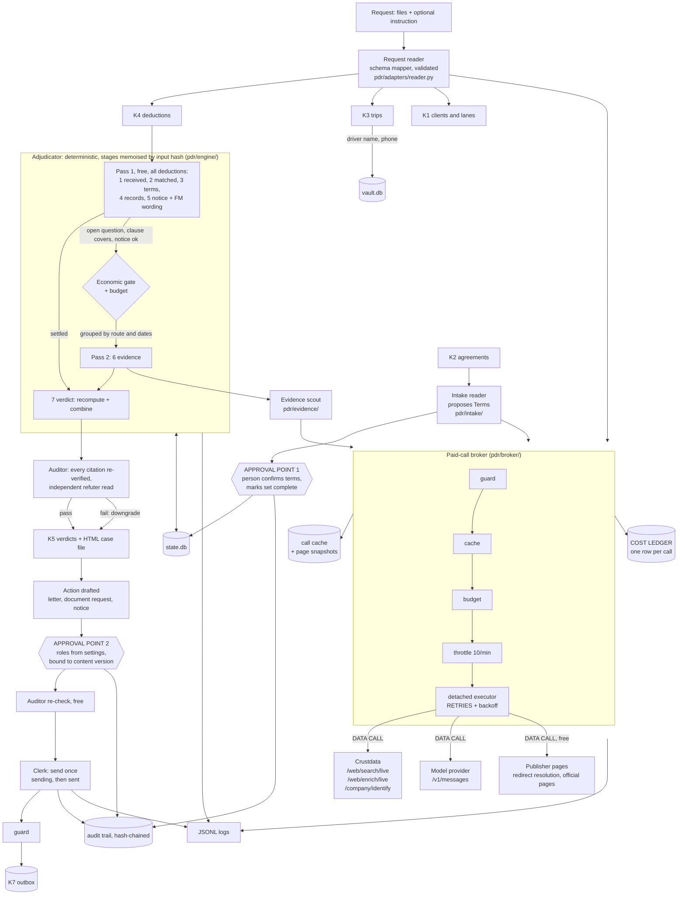
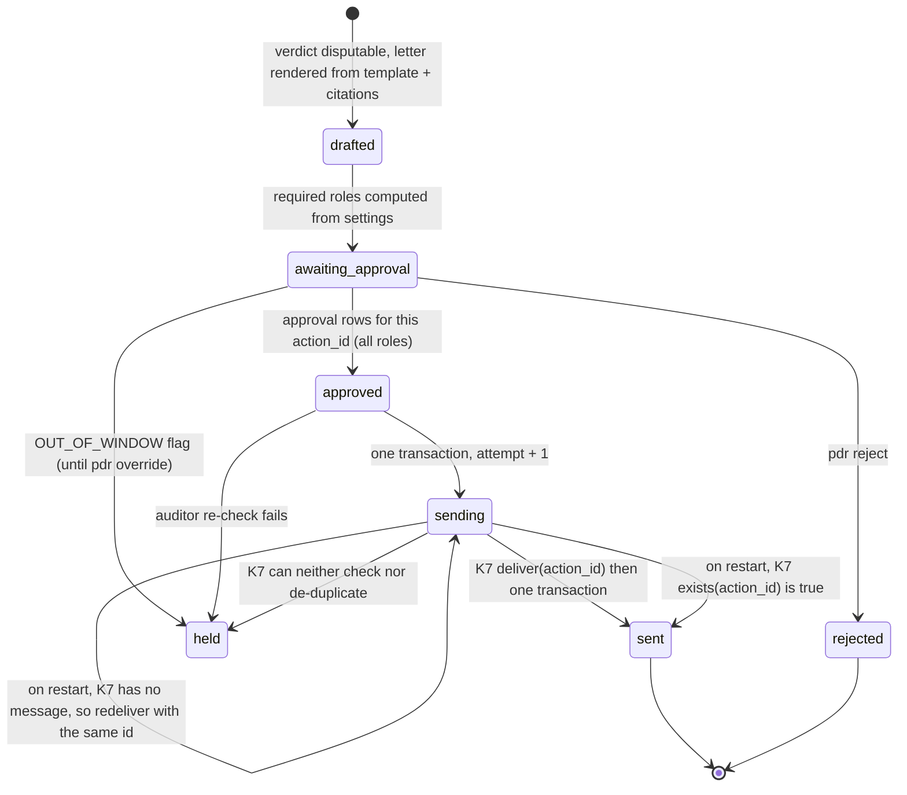
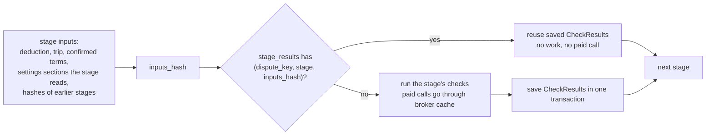

# Architecture

A set of narrow agents around a deterministic adjudicator. **Models read, code decides, people authorise.**
Source: DESIGN.md sections 1, 3, 5.3, 6 and 7. Every box below is a module in `pdr/`.

## Components and data flow

### Legend

| Mark | Where | What it means |
| --- | --- | --- |
| DATA CALL | Broker -> Crustdata, model provider, publisher pages | The only places the service leaves the machine. Each goes through `pdr.broker.paid_call`: guard, cache, budget, throttle, retries, ledger. |
| APPROVAL POINT 1 | Term confirmation | No extracted term is used until a named person confirms it; the agreement set must be marked complete for a "no contractual basis" ground. |
| APPROVAL POINT 2 | Approval gate before K7 | Nothing irreversible happens without approval rows for that exact action id (the id contains the content hash; editing the letter voids the approval). Roles come from `settings.yaml` (`approvals.*`). |
| RETRIES | Detached executor | Timeouts, 429 and 5xx are retried with backoff (`providers.crustdata.retry_limit`, `backoff_seconds`); one ledger row per attempt; exhausted retries give `PROVIDER_FAILED` for that deduction only. |
| COST LEDGER | Broker | One row per external or model call, including retries, blocked fetches and zero-cost cache hits; cost read from Crustdata's `x-credits-used` header. `pdr ledger`, `pdr economics`. |
| Auditor | Before writing a disputable verdict, and again before sending | Can only downgrade (to cannot verify) or hold; never upgrades. |
| vault.db | K3 adapter | Driver names and phones are split off at the door; the engine sees only `driver_ref`. |

## Send-once state machine (one Action)

Every command starts by reconciling actions left in `sending` against K7 by `action_id`. The local K7 outbox writes
one file per `action_id` by atomic rename, so "one message per dispute" is `ls data/outbox`.

## Memoised stages (restart = re-run)

A kill, a settings change, a new document and a changed client record are all handled the same way: run the same
command again. Unchanged stages are reused. Changed ones recompute, and any paid call they repeat is a cache hit
ledgered at zero cost.
