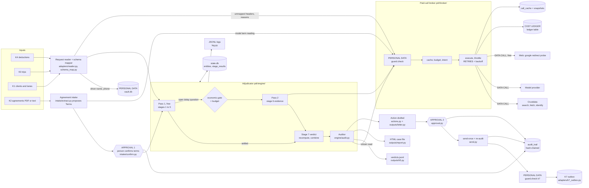
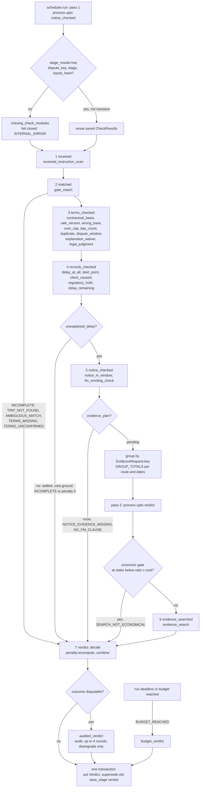
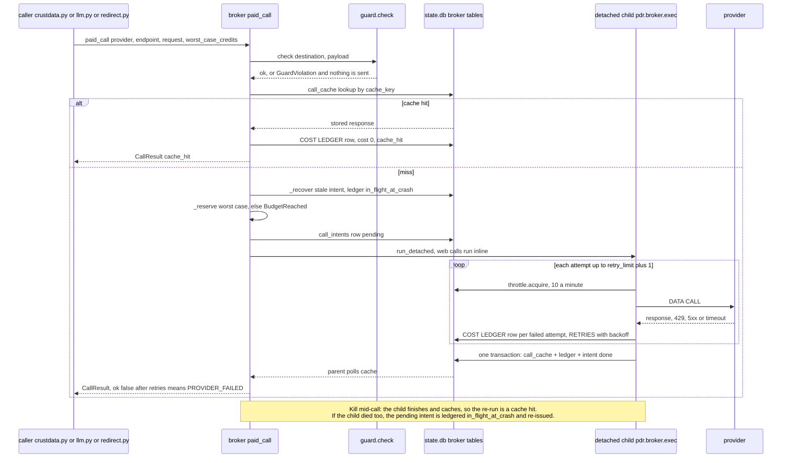
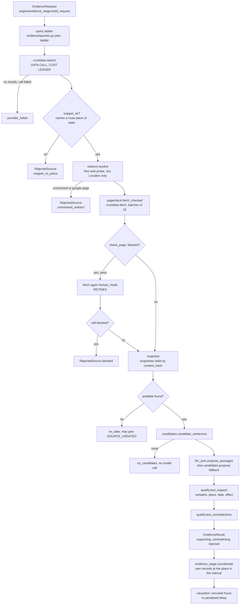
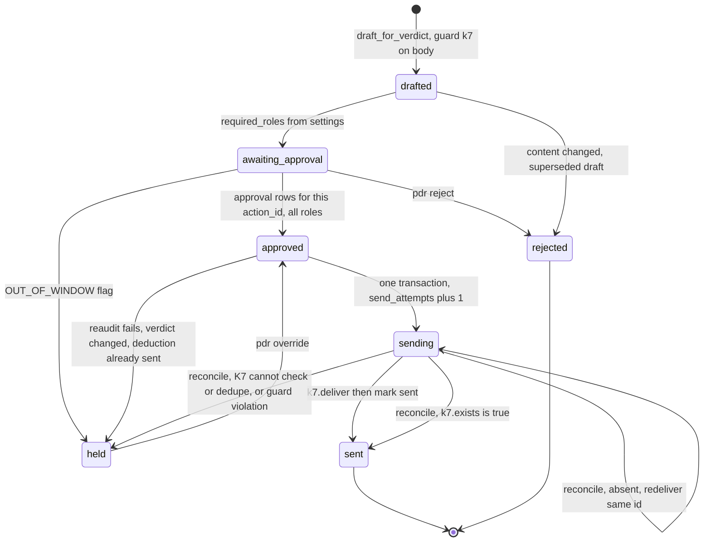
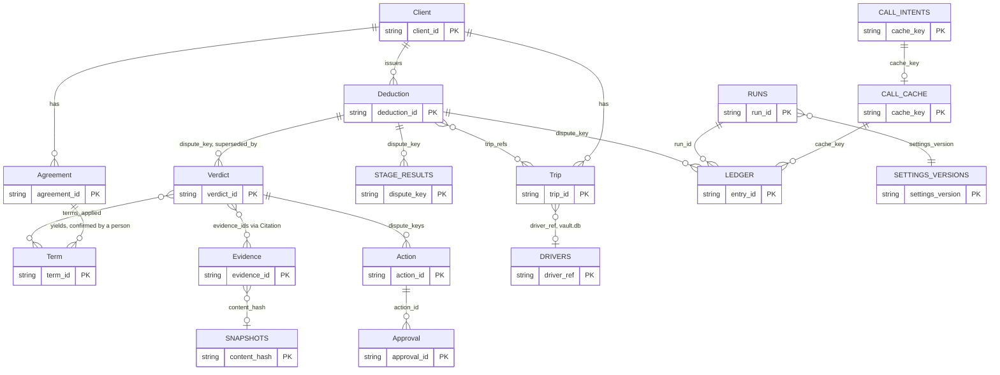
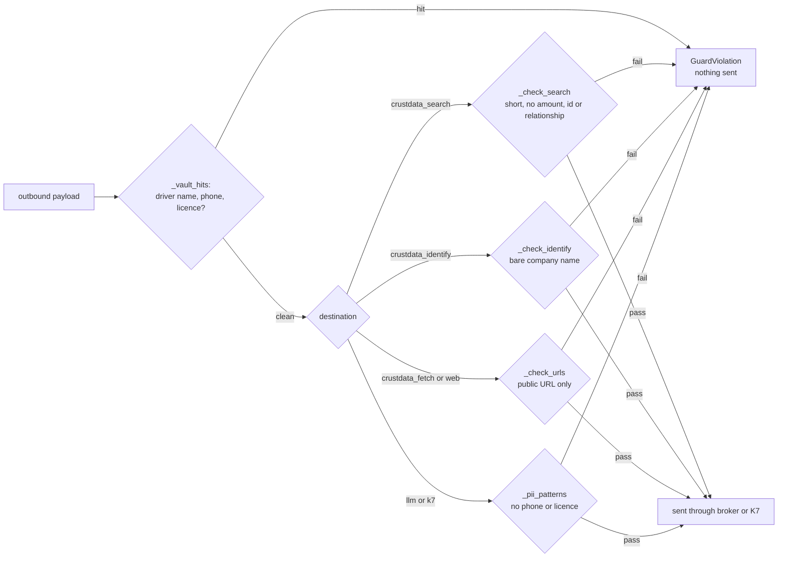

# Architecture

A set of narrow readers around a deterministic adjudicator. **Models read, code decides, people authorise.**
Every box below is a real module in `pdr/`; the diagrams follow the code on `main`, and the last section lists
where the code differs from `docs/context/DESIGN.md`.

Labels used throughout: **DATA CALL** (something leaves the machine), **APPROVAL** (a named person must act),
**RETRIES** (automatic retry with backoff), **COST LEDGER** (one row per call), **PERSONAL DATA** (the guard and
vault boundary).

## 1. System overview

Files come in on the left: the client's deduction advice (K4), trip records (K3), client list (K1) and agreements
(K2). Agreement terms are proposed by a reader and used only after a person confirms them. The adjudicator then
works through seven stages; only stage 6 (evidence) spends money, and every outside call goes through one broker
that checks the guard, cache and budget, retries, and writes the cost ledger. Results come out as a verdict file
and an HTML case file; a dispute letter is sent only after approval, exactly once, into the outbox (K7).

| Mark | Where in code | What it means |
| --- | --- | --- |
| DATA CALL | `pdr/broker/core.py` `paid_call` | The only way anything leaves the machine. Crustdata (`/web/search/live`, `/web/enrich/live`, `/company/identify`) through `pdr/evidence/crustdata.py`; the model through `pdr/llm.py` `llm_json`; the free web redirect probe through `pdr/evidence/redirect.py`. |
| APPROVAL 1 | `pdr/intake/confirm.py` `confirm`, `complete_set` | No extracted term is used until a named person confirms it; "no contractual basis" needs the set marked complete. |
| APPROVAL 2 | `pdr/approval.py` `approve`, `reject`, `override` | Approval rows are bound to the `action_id`, which contains the content hash; editing the letter voids them. Roles come from `settings.yaml`. |
| RETRIES | `pdr/broker/core.py` `execute` | Timeouts, 429 and 5xx retried up to `retry_limit` with backoff, jitter and `retry-after`. Exhausted retries give `PROVIDER_FAILED` for that deduction only. Blocked pages get one extra `human_mode` fetch (`pdr/evidence/pagecheck.py`). |
| COST LEDGER | `ledger` table, `pdr/broker/ledger.py`, `pdr/economics.py` | One row per attempt, per cache hit (zero cost) and per call killed in flight (`in_flight_at_crash`, assumed charged). |
| PERSONAL DATA | `pdr/guard.py`, `pdr/vault.py` | Driver names and phones are split into `vault.db` at the door; the engine sees only `driver_ref`. The guard checks every outbound payload. |

## 2. Verdict pipeline

Each deduction runs through seven stages. Stages 1 to 5 are free and run for every deduction in pass 1; anything
that settles early (no match, missing terms, no delay left to excuse) skips straight to the verdict. Deductions that
still need public evidence are grouped by route and dates for pass 2, where an economic gate refuses searches that
cost more than they could recover. A stage whose inputs have not changed is reused from `stage_results`, and a
disputable verdict is audited before it is written.

- **Memoisation** (`pdr/engine/pipeline.py` `run_stage`, `stage_hash`, `pdr/engine/hashing.py`): the hash covers
  the deduction, trip, confirmed terms, the settings sections the stage's checks declare, and the hashes of earlier
  stages. Results with a transient reason (for example `PROVIDER_FAILED`) are re-run.
- **Fail closed**: a stage whose check module did not import, or which has no registered checks, yields
  `INCOMPLETE / INTERNAL_ERROR`, never `NO_GROUND`. An audit that raises downgrades every ground to `INTERNAL_ERROR`.
- **Always answer**: `scheduler.run` gives every key still undecided a `budget_verdict` (`BUDGET_REACHED`).
- Stage 6 exits (`pdr/engine/evidence_stage.py`): `EVIDENCE_PARTIAL`, `NO_EVIDENCE_FOUND`, `SOURCE_UNDATED`,
  `SOURCES_CONFLICT`, `PROVIDER_FAILED`, `BUDGET_REACHED`, `CAUSATION_PARTIAL`, `FM_WORDING_ARGUABLE` (refer).

## 3. A paid call

Every outside call follows the same steps. The guard runs first, so a payload with personal data is never sent.
A cached answer is reused at zero cost (still ledgered). Otherwise the worst-case cost is reserved against the
run and per-deduction budgets, an intent row is written, and a detached child process does the call so that a kill
of the main process cannot lose a paid response.

Crash points named in the code: `call.after_intent`, `call.after_response_before_cache`, `call.after_cache`
(`pdr/crashpoints.py`, triggered with `PDR_CRASH_AT`).

## 4. Evidence search

When a 3PL says a disruption (a strike, a flood, a road closure) caused the delay, the scout looks for a dated
public report. Searches use only route places, dates and event words. Pages are checked for block pages, saved as
snapshots, and read: a model may propose passages, but code decides whether a passage qualifies by a four-part test
(verbatim quote, place, date, effect). News alone never wins a dispute; it must be corroborated by the 3PL's own
records.

The scout stops at the first ladder rung that yields a qualifying source, and respects `max_fetches_per_deduction`
and `max_blocked_fetches`. Link resolution (`pdr/evidence/redirect.py`) on `main` sends our own GET with redirects
off through the broker as provider `web`, caches only 3xx answers (a Google "Verifying" interstitial is retried
later), and rejects anything that lands on google.com. This module is being revised; the diagram shows `main` today.

## 5. Action lifecycle

A dispute letter, a document request and a force-majeure notice are all Actions with one protocol. The letter is
rendered from a template, never written by a model. It waits for approval from the roles the settings require,
is re-audited for free before sending, and is sent exactly once: after a crash, every action left in `sending` is
checked against the outbox by its id before anything else happens.

`pdr/send.py` `send_all` crash points: `send.after_lookup`, `send.after_intent`, `send.after_deliver`,
`send.after_mark_sent`. `pdr/cli.py` calls `send.reconcile` at the start of every command. The local outbox writes
one file per `action_id` by temp file and atomic rename, so "one message per dispute" is `ls data/outbox`.

## 6. Data model

Logical entities (`pdr/models.py`) are stored as JSON bodies in one `entities` table keyed by `(kind, id)`. The
other tables hold memoised stage results, the broker's write-ahead intents, cache and ledger, page snapshots, the
hash-chained audit trail, and housekeeping. Driver identity lives in a separate `vault.db`.

| Table (`pdr/schema.sql`) | Key | Holds |
| --- | --- | --- |
| `entities` | `(kind, id)` | Client, Agreement, Term, Trip, Deduction, Evidence, Verdict, Approval, Action, SchemaMap, Request, LedgerEntry bodies |
| `stage_results` | `(dispute_key, stage, inputs_hash)` | CheckResults of one stage for one set of inputs |
| `call_intents`, `call_cache` | `cache_key` | write-ahead record and raw response of each paid call (broker only) |
| `ledger` | `entry_id` | COST LEDGER: one row per attempt, cache hit, blocked fetch, killed call |
| `throttle` | none | timestamps for the shared 10-a-minute limiter |
| `snapshots` | `content_hash` | extracted text and raw HTML path of each fetched page |
| `schema_maps` | `header_hash` | confirmed column-to-field mappings |
| `audit_trail` | `seq` | confirmations, approvals, overrides, sends, each with `prev_hash` and `row_hash` |
| `runs`, `settings_versions`, `pii_access_log` | `run_id`, `settings_version`, `id` | housekeeping |
| `vault.db`: `drivers`, `pii_access_log` | `driver_ref` | driver name, phone, licence; every read logged |

## 7. What leaves the machine

Only four destinations exist, and `pdr/guard.py` `check` inspects every payload before it goes. Every destination
is scanned for any driver name, phone or licence held in the vault. Search queries are kept short and generic so
that nothing about the client, the amount or the dispute reaches a search provider.

| Destination (guard name) | What is sent | Never sent | Enforced where |
| --- | --- | --- | --- |
| Crustdata search (`crustdata_search`) | route place names, dates, event words | amounts, ids, words like penalty or invoice, queries over 10 words or 120 chars, phones, licences, vault values | `guard._check_search`, `_pii_patterns`, `_vault_hits`; called in `broker.paid_call` |
| Crustdata identify (`crustdata_identify`) | bare company names | numbers, ids, relationship words, emails, vault values | `guard._check_identify` |
| Crustdata fetch and web probe (`crustdata_fetch`, `web`) | public `http(s)` URLs | anything that is not a public URL, vault values | `guard._check_urls` |
| Model provider (`llm`) | article text, agreement text, column headers, reason text | phones, licences, vault values | `guard.check` on `llm_json` payload via broker |
| K7 outbox (`k7`) | letter body, action id, business references | phones, licences, vault values | `actions.draft_for_verdict`, `adapters/k7_outbox.py` `deliver` |

## 8. Module map

Lanes: **A** everything that costs money, **B** the adjudicator, **C** what must happen once and what people see,
**D** what comes in, personal data and documentation.

| Module | Responsibility | Lane |
| --- | --- | --- |
| `pdr/broker/core.py` | `paid_call`: guard, cache, budget, intent, execute with retries, cache + ledger | A |
| `pdr/broker/exec.py` | detached child executor, `paid_calls_parallel` | A |
| `pdr/broker/db.py`, `throttle.py`, `transport.py`, `http.py` | broker connection, shared rate limit, transports | A |
| `pdr/broker/ledger.py` | `rows`, `totals` readers of the COST LEDGER | A |
| `pdr/evidence/crustdata.py` | Crustdata `search`, `fetch`, `identify` | A |
| `pdr/evidence/redirect.py` | resolve google redirect links, free | A |
| `pdr/evidence/scout.py` | `find_evidence`: ladder to EvidenceResult | A |
| `pdr/evidence/queries.py`, `pagecheck.py`, `pubdate.py` | query ladder, block-page check and snapshot, publication date | A |
| `pdr/evidence/candidates.py`, `qualify.py` | candidate sentences, deterministic proposer, four-part test | A |
| `pdr/evidence/refuter.py`, `links.py` | independent re-read, passage links | A |
| `pdr/llm.py`, `pdr/prompts/` | `llm_json` model adapter and prompts | A |
| `pdr/engine/registry.py`, `pipeline.py`, `scheduler.py`, `hashing.py` | check registry, stages, memoisation, two passes | B |
| `pdr/engine/gate.py` | stages 1 and 2 | B |
| `pdr/engine/checks_terms.py`, `checks_records.py`, `checks_notice.py` | stages 3, 4, 5 | B |
| `pdr/engine/evidence_stage.py` | stage 6, economic gate, corroboration, causation | B |
| `pdr/engine/penalty.py`, `combine.py`, `audit.py`, `explain.py` | stage 7: recompute, combine, auditor, explanation | B |
| `pdr/engine/timeline.py`, `calendar.py` | which record wins, day counting | B |
| `pdr/store.py`, `store_mem.py`, `schema.sql` | SQLite and in-memory stores | C |
| `pdr/settings.py`, `runctx.py`, `log.py`, `crashpoints.py` | settings, run context, JSONL logs, crash points | C |
| `pdr/actions.py`, `approval.py`, `send.py` | draft, approve, send once, reconcile | C |
| `pdr/outputs/k5.py`, `derived.py`, `report.py`, `letter.py`, `atomic.py` | verdicts.jsonl, HTML case file, letter, atomic writes | C |
| `pdr/cli.py`, `cli_actions.py`, `doctor.py`, `economics.py` | CLI, preflight, money views | C |
| `pdr/adapters/reader.py`, `schema_map.py`, `reason_map.py`, `k1` to `k4` | request reader and input adapters | D |
| `pdr/adapters/k5_output.py`, `k6_runner.py`, `k7_outbox.py` | output, runner and outbox adapters | D |
| `pdr/intake/`, `cli_intake.py` | agreement intake and term confirmation | D |
| `pdr/guard.py`, `vault.py` | outbound guard and driver vault | D |

## Differences from the design doc

- **Throttle sits inside each attempt.** DESIGN 6 lists throttle as a step before execute; in `broker/core.py`
  `execute` acquires the throttle before every attempt, including retries.
- **Web calls never run detached.** `paidcall_mode` forces `inline` for provider `web`, for in-memory stores and on
  Windows; Crustdata and model calls are `detached` by default (`settings.yaml`).
- **Redirect probes cache only 3xx.** A 200 (Google interstitial) is not cached and the link is rejected as
  `unresolved_redirect`; DESIGN 8.3 describes a plain Location read.
- **The verdict is audited up to four rounds** and can only be downgraded (`pipeline.no_raise`); an audit that
  raises turns grounds into `INTERNAL_ERROR`. DESIGN 8.5 describes a single pass.
- **Stage 5 runs only if a delay is unexplained** (`pipeline.unexplained_delay`), and stage 6 additionally needs an
  `evidence_plan`; DESIGN 5.3 runs stage 5 for every deduction in pass 1.
- **Pass 2 runs group members one after another.** DESIGN 5.3 describes bounded concurrency inside a group; in
  `scheduler.run` the first member pays for the search and the others reuse it through the call cache and the
  run memo (`evidence_stage.reset_run_memo`), with the gate applied to the group total (`GROUP_TOTALS`).
- **Two `pii_access_log` tables** exist: one in `state.db` (schema) and the one actually written in `vault.db`.
- **Undated pages** are rejected as `no_date`; `SOURCE_UNDATED` is returned only when such a page also had candidate
  sentences.
