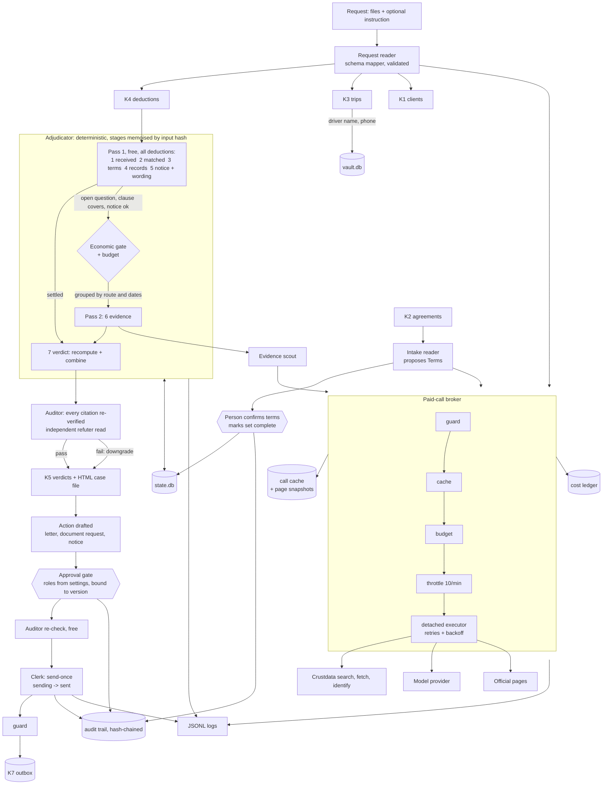

# DESIGN: how we build the penalty-deduction recovery service

**Version 2, 22 Nov 2026.** Companion to `PRD.md` (what to build) and `REFERENCE.md` (facts). This file says **how**: components, algorithms, storage and the protocols that make kills safe. The exact types and signatures every lane codes against are in `INTERFACES.md`. Every choice that goes beyond the PRD has a D-number in `DECISIONS.md`.

Version 2 fixes the architecture after a review against the scoring rubric. What changed from version 1 is listed in `DECISIONS.md` §2b (D-20 to D-34). If this file and the PRD disagree, the PRD wins unless `DECISIONS.md` §2c records the departure.

## 1. The architecture in one page

**A system of narrow agents around a deterministic adjudicator.** Models read; code decides; people authorise.

| Part | Kind | Does | Can never |
| --- | --- | --- | --- |
| **Request reader** | Model + validation | Maps an unseen input (sheet, PDF, pasted email, a sentence of instruction) onto the logical model | Supply a value that is not in the source text |
| **Intake reader** | Model + validation | Proposes contract Terms with page, clause and verbatim text | Confirm a term; only a person does |
| **Evidence scout** | Code-planned search + model reader | Finds dated public reports for a route and window; proposes which sentences state event, place, date, effect | Write its own queries from client data; decide a verdict |
| **Adjudicator** | Deterministic code | Runs the checks, recomputes the correct penalty, combines results into a verdict | Use a fact without a citation; treat an unfinished check as "no ground" |
| **Auditor** | Code + an independent model read | Re-verifies every citation of a disputable verdict before it is written, and again before anything is sent | Upgrade a verdict; it can only downgrade or hold |
| **Clerk** | Deterministic code | Executes approved actions exactly once | Act on anything without approval rows for that exact version |
| **People** | Billing lead, account manager, finance, legal | Confirm terms, approve actions, override with a logged reason | — |

The one-sentence version for judges: *the only component that can move a verdict toward "disputable" is deterministic code working from confirmed terms and cited records; models can only propose evidence or veto it.*

Five mechanisms carry everything else:

1. **Memoised stages** (Section 5.3). Every stage result is stored under a hash of the inputs it read. Restart after a kill, re-run after a settings change, re-run after a new document arrives, and re-run after the organisers change a record are all the same operation: run again, reuse what is unchanged.
2. **Paid-call broker** (Section 6). Every call that costs money goes through one function: guard, cache, budget, throttle, retries, ledger.
3. **Action outbox** (Section 7). Every irreversible action (dispute letter, missing-document request, force-majeure notice, a payment in test mode) is an Action with a fixed id, approval rows and a send-once protocol.
4. **Outbound guard** (Section 10). Everything leaving the machine passes one check for personal data and confidentiality.
5. **Settings** (Section 9). Everything a judge is likely to change is in one validated file with no place to put a contract value.

How this maps to the scoring:

| Scored item | Design answer |
| --- | --- |
| Screening: hidden set, wrong answer worse than cannot verify | Typed check results (5.1); permitted-readings rule (5.4); strict identity matching (5.7); citation audit before any dispute (8.5) |
| Screening and live run (20): an **unseen** request | Request reader with a validated schema mapper (5.2); fail-closed barrier so one bad row never stops a run (5.9); answers always written, incrementally and idempotently (11) |
| Sources for every fact | Citations are typed objects; each carries a link that opens at the passage; fetched pages are snapshotted (8.6) |
| Robustness (15): kill at a random moment, each action once | Memoised stages; broker with detached executor; action outbox with one file per id; outputs rendered from the store, never appended |
| Design (15): live fix, 100x, second client | Settings; check registry (5.8); memoised re-run shows the fix in seconds without paying again |
| Ethics (25) | Vault split at the adapter; one guard; approvals bound to the exact version; auditor re-verifies before sending; tamper-evident audit trail; verdicts say what would change them |
| Finance (25) | Ledger reads the provider's own `x-credits-used`; economic gate before paid search; `pdr economics` shows measured cost, fee and margin per verdict type |

## 2. Stack

| Choice | Decision | Reason |
| --- | --- | --- |
| Language | Python 3.10+ (3.12 is at `~/.local/bin/python3.12` on the shared machine) | Whole team reads it; test scripts already in Python |
| Storage | SQLite, one file `data/state.db`, WAL, `synchronous=FULL`, `busy_timeout=5000` | Atomic, zero setup, survives `kill -9`, safe with the detached executor writing alongside. `/projects` is local xfs, so WAL is safe on the shared machine |
| Personal data | Second SQLite file `data/vault.db` | Physical separation makes "driver data never leaves" checkable |
| Models | pydantic v2 for entities and settings | Validation at every boundary |
| HTTP | `httpx` (sync) | Timeouts; requests with redirects off for link resolution |
| Article text | `trafilatura` (fallback: tag strip) | Plain stripping picks up navigation text (RESULTS.md) |
| Config | `settings.yaml` + pydantic schema | Hour-3 and live fix edit one file |
| Interface | `typer` CLI is the system of record; a **static HTML case file** is rendered from the store; a live FastAPI page is optional | A CLI is an allowed form of service; the case file is what non-technical judges read |
| Model provider | Behind `pdr/llm.py`; Claude by default (`claude-sonnet-5-5` for term and passage reading, `claude-haiku-5-5` for field parsing), switchable in settings, second provider configured as fallback | Team brings its own key; **none is in the environment yet** (PLAN P-3) |
| Tests | `pytest`; recorded provider responses replayed by a fake transport | Mock data is allowed for tests only; live mode for the demo |

No agent framework. Each "agent" above is a function with a typed input and output; the orchestration is a loop over stages. That is easier to restart, to cite and to explain.

## 3. Components and data flow



This is the base for `docs/architecture.md`. It marks the data calls (broker), both approval points, retries (executor) and the ledger, as the PDF requires.

## 4. Storage

One SQLite database. Entities are a JSON body plus the columns we query on (DDL in `INTERFACES.md` §6).

| Table | Holds | Key |
| --- | --- | --- |
| `entities` | Clients, agreements, terms, trips, deductions, evidence, verdicts, approvals, actions | `(kind, id)` |
| `stage_results` | Check results of one stage of one deduction for one set of inputs | `(dispute_key, stage, inputs_hash)` |
| `call_intents`, `call_cache` | Write-ahead record and raw response of each paid call | `cache_key` |
| `snapshots` | Extracted text and raw HTML path of every fetched page | `content_hash` |
| `ledger` | One row per call attempt, cache hit, blocked fetch | `entry_id` |
| `schema_maps` | Confirmed column-to-field mappings for input shapes | `header_hash` |
| `audit_trail` | Confirmations, approvals, overrides, sends; each row holds the hash of the previous row | sequence |
| `runs`, `settings_versions`, `throttle`, `pii_access_log` | Housekeeping | — |

Rules:

- A stage's results are written in one transaction with the deduction's stage marker. There is no moment where one exists without the other.
- Verdicts are immutable. A re-run with different inputs writes a new verdict and marks the old one superseded.
- One writer for entity and stage tables (the main process). The detached executor writes only `call_cache`, `snapshots` and `ledger`.
- **Outputs are rendered from the store.** `verdicts.jsonl`, the case file and the ledger export are regenerated atomically (temp file, rename) after each verdict, never appended. A kill cannot produce a duplicate or half line.
- Times are ISO 8601 with offset; input without an offset is read as IST and the assumption is recorded on the observation.

## 5. The adjudicator

### 5.1 Check results, not booleans

Every check returns a `CheckResult` with one of five statuses:

| Status | Meaning | Can lead to |
| --- | --- | --- |
| `GROUND` | A ground is fully supported by a cited term and cited facts | disputable |
| `NO_GROUND` | The check finished and found nothing | valid |
| `NOT_APPLICABLE` | The check does not apply (no cap clause, so no over-cap check) | valid |
| `INCOMPLETE` | The check could not finish; carries a reason code and the named missing item | cannot verify |
| `REFER` | The check finished but the decision belongs to a person | cannot verify |

There is no "unknown" that silently reads as false. This is how "valid requires every check to have finished" is enforced by type rather than by discipline.

### 5.2 Reading an unseen request (D-26)

The finals and screening both hand us input we have not seen. Stage 0 exists so that this is routine:

1. **Request interpreter.** If the request comes with a sentence of instruction, a model classifies it into one of the request types we support (check deductions; take in an agreement; show status) and extracts its parameters (client, period, file). Anything else returns an honest "unsupported request: this service checks penalty deductions" with what it would need. It never guesses a job.
2. **Schema mapper.** For a tabular or semi-structured file whose headers we have not seen, a model proposes a mapping from its columns to logical-model fields. Code then **validates the mapping by parsing the actual values**: dates parse as dates, amounts as amounts, LR numbers match the trips we hold. A mapping that fails validation is discarded. A valid one is shown to the operator in one screen, stored in `schema_maps` under the hash of the headers, and reused silently next time.
3. **Free text** (email, PDF note) is parsed field by field; every extracted value must be found verbatim in the source text.
4. A required field that cannot be mapped does not stop the run: the affected deductions go to cannot verify naming the field.

Known shapes skip the model entirely through `adapters.k3/k4.field_map` in settings.

### 5.3 Stages, memoised (D-20)

| Stage | Checks | Paid? | Can end early with |
| --- | --- | --- | --- |
| 1 received | Logical model; `dispute_key`; instruction scan; resubmission check | Model only for unseen shapes | Resubmission: existing verdict returned |
| 2 matched (gate) | Client, trip, agreement in force, terms confirmed (5.7) | Identify only to explain a lookalike | `AMBIGUOUS_MATCH`, `TRIP_NOT_FOUND`, `TERMS_MISSING`, `TERMS_UNCONFIRMED` |
| 3 terms_checked | Basis; rate version; duplicate; window; waiver; arithmetic on the client's own timestamps | No | — |
| 4 records_checked | Timeline resolution; delay at all; wrong start point; client-caused intervals; regulatory hold | No | — |
| 5 notice_checked | Is a disruption asserted? Notice in the clause's window; FM wording | No | `NOTICE_EVIDENCE_MISSING`, `FM_WORDING_ARGUABLE`, `NO_FM_CLAUSE` |
| 6 evidence_searched | Economic gate; search, resolve, fetch, page check, date, passage test, contradiction, corroboration | **Yes** | `BUDGET_REACHED`, `SEARCH_NOT_ECONOMICAL`, `PROVIDER_FAILED`, `EVIDENCE_PARTIAL`, `SOURCES_CONFLICT`, `SOURCE_UNDATED`, `NO_EVIDENCE_FOUND` |
| 7 verdict | Recompute; combine; audit; explanation | Refuter read only on the path to an FM ground | — |

**Memoisation.** Before running a stage, the pipeline computes `inputs_hash` over exactly what that stage reads: the deduction's fields, the matched trip, the terms in scope with their confirmation stamps, the settings sections the stage declares, the hashes of the earlier stages' results, and the rule version. If `stage_results` holds a row for `(dispute_key, stage, inputs_hash)`, the stage is skipped.

One mechanism therefore covers four situations that would otherwise each need their own code:

| Situation | What happens |
| --- | --- |
| Killed and restarted | Same inputs, same hashes: finished stages are skipped, the interrupted one runs |
| Settings changed (hour 3, live fix) | Only stages that read the changed section recompute; paid calls are still cache hits, so the re-run is fast and free |
| A missing document is uploaded and confirmed | Terms in scope change; stages 2 onward recompute for the affected deductions only |
| Organisers change a client record mid-build | The trip or client hash changes; affected deductions recompute |

**Two passes (D-22).** A run first takes *every* deduction through the free stages 1–5, writing verdicts for those already settled, so answers appear within seconds. It then groups the remaining deductions by their evidence request (route places, window, event types). One search serves the whole group, and the economic gate (5.6) is applied to the group's total. Paid calls inside a group run with bounded concurrency through the executor; results are applied by the single main thread.

### 5.4 The recomputation model (D-05, D-06)

The engine computes one figure, the **correct penalty**, by applying each *supported* correction to the client's own calculation:

1. Start from the client's stated event, timestamps, rate, base and day count.
2. **Term corrections** (stage 3): the confirmed rate in force on the trip date; the base the clause names; the clause's day-count rule; then the confirmed cap.
3. **Fact corrections** (stage 4): a client timestamp replaced by the governing record where the source-priority table says so.
4. **Excused intervals** (stages 4 and 6): client-caused waits, regulatory holds and force-majeure halts each produce an interval with citations. Their **union** shifts the due time forward, as GeM GTC 15(i) re-fixes the delivery date. The penalty is recomputed against the shifted due time. Overlapping excuses cannot be counted twice.
5. `amount_disputable = deducted − correct_penalty`, clamped to `[0, deducted]`.

Corrections apply in a fixed order and each one's effect is recorded, so the case file shows the recomputation line by line and attributes rupees to grounds. All-or-nothing grounds (no contractual basis, duplicate, no delay) set the correct penalty to zero.

Guards:

- **Permitted-readings rule.** Where the confirmed clause is silent on something that changes the figure (does a part day count? is the cap per trip or per month?), compute every reading the wording permits and treat the **highest** penalty as correct. We dispute only what no reading allows.
- **Missing base values.** If a base or cap needs a figure we do not hold, that one check is `INCOMPLETE` naming the figure; the others proceed.
- `Decimal` throughout; one rounding to paise at the end.

**Timeline resolution.** Each trip event holds a list of observations with source and reference. The resolver applies the PRD's "which record wins" table. If a fallback differs from the first choice by more than the allowance, the timestamp is *in conflict*, and every check that depends on it returns `INCOMPLETE / RECORDS_CONFLICT`. Checks that do not depend on it are unaffected.

### 5.5 Is a disruption asserted? (D-03)

A disruption is **asserted** when the trip's records hold an ops note or driver report of a blockage, a notice sent to the client, a detention memo reference, or a halt the 3PL flagged.

| Situation | Path |
| --- | --- |
| No unexplained delay after stage 4 | Stages 5–6 skipped. No paid call |
| Asserted; clause requires notice; no notice record in window | `INCOMPLETE / NOTICE_EVIDENCE_MISSING`. No search (case 12c) |
| Asserted; wording arguable or no clause | `REFER`. No search unless `search_for_referrals` |
| Asserted; wording excludes it | FM check `NO_GROUND`, flag `CLIENT_ADMISSION_CHECK`. No search (case 12b) |
| Asserted; covered; notice ok | Search for that event type |
| **Not asserted**; clause names event types | **Discovery search**. Zero results cost nothing. Nothing qualifying: `NO_GROUND`, search log cited (cases 2, 3, 17). Something qualifying: notice and corroboration still apply, so the result is `INCOMPLETE`, never a ground on news alone |
| Not asserted; no clause or nothing named | `NOT_APPLICABLE`. No search |

**Wording.** `fm_wording(term, event_type)` is a lookup over the confirmed term's own lists, never a list in code or settings: excluded → `EXCLUDED`; named → `COVERED`; only general words → `ARGUABLE`; no term → `NO_CLAUSE`. The `disruption_types` setting limits what we *search* for; it cannot make a clause cover anything.

### 5.6 Economic gate (D-28)

Before any paid search, the stage compares the amount that could be recovered across the group with the estimated cost of the search (from the ledger's running average, or the setting until there is one). Below the configured ratio, the search does not run and the check is `INCOMPLETE / SEARCH_NOT_ECONOMICAL`, naming both figures. A person can force it. We do not spend Rs 200 chasing Rs 150, and the finance judge can see that we do not.

### 5.7 Identity, lookalikes and duplicates (D-08, D-27)

The hidden set contains a lookalike name and a duplicate. Matching is strict by design:

- **Client**: exact match on the normalised legal name or on an alias a person has confirmed. Anything else is `AMBIGUOUS_MATCH`, listing the candidates. Crustdata identify is used to *show* why two names differ (company id, domains), never to resolve the match on its own.
- **Trip**: exact match on LR, invoice or e-way bill number after normalisation. One character off is not a match. Two trips matching is `AMBIGUOUS_MATCH`.
- **Place**: see 8.3; an ambiguous place name must appear with its state or district.
- `dispute_key = norm(client_id) | norm(advice_no) | norm(line_no)`, or the client's deduction number, or a hash of fixed fields. `norm` keeps only letters and digits, upper-cased, so the same deduction in a sheet and in an email gives the same key (case 18).
- `event_fp = hash(client_id, trip_id, reason_code)`. Same `dispute_key` again is a **resubmission** (nothing new created). Same `event_fp` under a different key is a **duplicate deduction**: ordered by deduction date, advice number, line number (never arrival order); the earliest follows its own verdict, each later one is `GROUND / DUPLICATE` for its full amount.

### 5.8 Check registry (D-33)

Each check is a function registered with its stage, the timeline events and term types it depends on, and the settings sections it reads:

```python
@check(stage="terms_checked", needs_terms=["penalty_rule", "cap"], settings=["records"])
def over_cap(ctx) -> CheckResult: ...
```

The pipeline runs whatever is registered for a stage. A live fix that adds a rule is one function and its decorator; nothing in `combine` changes. The registry also gives memoisation its list of settings sections per stage, and gives the case file its "checks run" table.

### 5.9 Combine, and failing closed (D-04, D-25)

```
if a gate check is INCOMPLETE                      -> cannot_verify (that reason)
elif at least one GROUND and deducted - correct_penalty > 0
                                                   -> disputable for that amount;
                                                      INCOMPLETE/REFER checks listed as unresolved, never added
elif any INCOMPLETE or REFER                       -> cannot_verify (primary reason by precedence, all listed)
else                                               -> valid
flags never change the outcome
```

- A ground whose dependency is conflicted or unconfirmed is downgraded to `INCOMPLETE` before combine runs.
- **Fail closed.** Each check runs inside a barrier. An unhandled error becomes `INCOMPLETE / INTERNAL_ERROR` for that check on that deduction, logged with its trace; the run continues. A bug can cost us a cannot verify; it cannot produce a wrong valid or disputable, and it cannot stop the other deductions.
- When the run's deadline or budget is reached, every undecided deduction still gets a verdict (`BUDGET_REACHED`), so a run always returns a complete answer set.
- `OUT_OF_WINDOW` sets the next action to "held for account manager" and blocks drafting until an override exists.
- **What would change this.** Every cannot verify names the item that would decide it. Every valid lists the checks that ran. Every disputable lists what, if shown, would defeat it (for example "a client gate log showing a different loading time").

## 6. Paid calls: the broker

Every call that costs money or leaves the machine goes through `paid_call()`. Nothing else imports an HTTP client.

1. **Guard** inspects the request (Section 10). A violation raises; nothing is sent.
2. **Cache lookup** by `cache_key = sha256(provider | endpoint | canonical request)`. A hit writes a zero-cost ledger row and returns.
3. **Budget check** against run and per-deduction limits, using the call's worst-case cost. Short: `BudgetReached`.
4. **Intent** row written and committed.
5. **Throttle**: token bucket, 10 a minute for Crustdata, shared through the database.
6. **Execute with retries**: timeouts, 429 and 5xx retried with backoff and jitter up to the setting; one ledger row per attempt. Exhausted: `PROVIDER_FAILED`.
7. **Raw response written to `call_cache` and the ledger in one transaction, before any parsing.**

**Surviving a kill mid-call (D-07).** Searches take 6–21 seconds and fetches 10–25, so a random kill is likely to land inside one. Step 6 runs in a **small detached child** (`python -m pdr.broker.exec <cache_key>`, own session). The parent polls the cache. If the parent is killed, the child finishes and writes the result; on restart it is a cache hit. If the child dies too, the intent is still `pending`: we write a ledger row `in_flight_at_crash` ("cost unknown, assume charged") and re-issue. Build order: inline first, detached second; `paidcall_mode: inline` remains as a switch, and is automatic on Windows.

**What is cached.** The raw response, keyed by the request. Evidence queries are built only from route places, dates and event words, so two deductions on the same route and dates share the result. That is the PRD's route-date cache with no extra structure. Model calls are cached the same way, which makes re-runs reproducible.

**Ledger and budget.** Cost per call comes from the provider's `x-credits-used` header when present, else from the price table in settings; tokens from the response's usage block. The rupee rate is a setting stamped on each row. Blocked fetches are ledgered at their real cost. The run has a cost limit, a per-deduction limit and a wall-clock deadline checked before each stage and each call.

**Degraded mode.** If a provider is unreachable (venue network), free-check verdicts are unaffected, route-dates already in the cache still resolve, and the rest return `PROVIDER_FAILED` with their stage saved. A later run finishes them.

## 7. Actions: approved, then exactly once (D-21)

A dispute letter is one kind of irreversible action. A request to the client for a missing document and a force-majeure notice are others; a payment in a provider's test mode would be a fourth. They share one entity and one protocol.

**Action** = `action_id` (the idempotency key), `kind`, content, required roles, status: `drafted → awaiting_approval → approved → sending → sent` (plus `held`, `rejected`).

- For a dispute letter, `action_id = dispute_key + ":" + letter_version[:12]`, where the letter version is the hash of the letter's content. Never random, never time-based.
- The letter is rendered from a template and the verdict's citations. No model writes a letter (D-14).
- Approval rows reference the exact version. Editing the content changes the hash and voids the approvals.
- Required roles come from settings and are re-evaluated on start if a threshold changed while the action was unsent.
- Each deduction can appear in at most one sent dispute.

**Protocol**

1. Look up `action_id` at K7. Present: mark `sent`, stop.
2. **Auditor re-check** of every citation behind the action (free; Section 8.5). Fail: `held`.
3. One transaction: status `sending`, attempt count + 1.
4. Deliver through the K7 adapter with `action_id` as the idempotency key.
5. One transaction: status `sent`, `sent_at`; audit-trail row.

**On every start**, before anything else, each action in `sending` is reconciled against K7 by id: present → `sent`; absent → redo step 4 with the same id. If the K7 adapter reports it can neither check nor de-duplicate, the action goes to `held` for a person. Never resent blind.

**The local outbox is idempotent by construction (D-15).** One file per action, `outbox/<action_id>.json`, written to a temp name, fsynced, atomically renamed. Existence is the check. "Exactly one message per dispute" is `ls outbox`, which can be shown on stage. An organiser endpoint or mailbox plugs in behind the same three methods (`capabilities`, `exists`, `deliver`).

**Crash points.** Named points are compiled in (`crashpoint("send.after_intent")`). With `PDR_CRASH_AT=<name>` the process exits there. The kill test loops over every point (run, die, run) and asserts one outbox file per action and no cache key paid twice. A second test sends real `SIGKILL`s at random times.

**Audit trail (D-31).** Term confirmations, set-complete marks, approvals, overrides and sends are appended to `audit_trail`; each row stores the hash of the previous row, so an edit after the fact is detectable. `pdr trail --verify` checks the chain.

## 8. The evidence scout

### 8.1 Route places (D-09)

Sources, in order: `route_places` on the trip record; a person-confirmed `lanes.yaml` per client (lane → districts, towns, named highway stretches, states, regional-language state name, and for each place its state and district); optionally OpenStreetMap routing, cached and ledgered as a free source. Never a model. No route places: evidence can never qualify, and the check is `INCOMPLETE / EVIDENCE_PARTIAL` naming "route places for lane X".

### 8.2 Query plan (D-01)

Queries are **constructed from an allow-list**: `<place> <event word>`, place from route places, event word from the vocabulary for event types the clause covers. A ladder, stopping at the first rung that yields a qualifying source or at the budget:

1. most specific place + event word ("Kini blockade");
2. state + event word ("Maharashtra chakka jam");
3. regional-language state name + event word.

Window: the in-transit window widened by the allowance. `location` is never sent. Query length is tuned by test, not fixed (DECISIONS F-1).

### 8.3 From search result to Evidence

For each result in rank order, up to `max_fetches_per_deduction`:

1. **Snippet pre-filter (free).** Drop results whose title and snippet name no route place and no route state.
2. **Resolve the link (free).** `google.com/goto?url=…` carries an opaque token. Request it ourselves with redirects off and take the `Location` header. Never fetch a google.com link through Crustdata.
3. **Fetch** through the broker, up to 10 URLs per call.
4. **Page check.** `success: true` is not trusted. Blocked if the **extracted text** is empty or under 1,500 characters, or the title or opening has a block phrase. Retry once with `human_mode: true`, then abandon; both ledgered. Stop after `max_blocked_fetches`.
5. **Snapshot.** Extracted text and raw HTML are stored under the content hash. The evidence exists from that moment whatever happens to the page later.
6. **Publication date** from the meta patterns in REFERENCE §1 plus `uploadDate` and `<time datetime>`. None: `fetch_status = no_date`; the page can only ever yield `SOURCE_UNDATED`.
7. **Candidate sentences (code).** Sentences that contain a route place or route state together with an event word are selected deterministically. No candidates: the page is rejected without a model call.
8. **Passage reading (model).** Only the article text goes to the model, never anything about the client. For each claim it must return a verbatim quote: event type; happened, only announced, or called off; places physically affected; event dates; effect on road or goods movement; any statement that a place or road was *unaffected*.
9. **Deterministic test** on the proposal:
   - every quote is a substring of the snapshot text after whitespace normalisation, or the proposal is discarded;
   - event type is one the client's clause covers;
   - **place**: a physically affected place is in the route places, **and** that place's state or district also appears in the article (Srirampur on the Assam–West Bengal border is not Shrirampur in Maharashtra). A highway number or name alone never matches: the Kini reports call NH-48 the "Pune–Bengaluru highway", which must not match a Pune–Mumbai trip (D-10, case 3). A statewide report matches only if the quote says road traffic stopped across the state;
   - **date**: event range overlaps the in-transit window; publication is on or after the event start and within the allowance after the window;
   - **effect**: a quote states road or goods movement stopped or was diverted;
   - status is "happened".
10. **Contradiction test.** An "unaffected" statement whose place is on the route becomes a contradicting Evidence record. A qualifying contradiction beside a qualifying support is `SOURCES_CONFLICT`, both shown (case 8).

Article text is untrusted input: it can be quoted, never obeyed.

### 8.4 Corroboration and causation

- News alone never carries a dispute. A supporting passage becomes a `GROUND` only with **own-record corroboration**: a GPS halt, FASTag gap or timed driver report placing the truck in an affected place during the event. An ops note that merely repeats the claim is not corroboration (case 7).
- `search_when_corroboration_missing` (default true, D-11) decides whether to spend credits when no such record exists at all. False is the first lever if the budget is cut.
- The excused interval is the corroborated halt inside the event's dates plus the causation allowance, capped by the delay. If the penalty is per event and the delay exceeds the excused interval: `INCOMPLETE / CAUSATION_PARTIAL`.
- `min_qualifying_sources` is a setting (default 1).

### 8.5 The auditor (D-23)

Runs on every verdict that would be disputable before it is written, and again (mechanical part only) immediately before any action is sent.

**Mechanical re-verification**, one rule per citation kind:

| Citation | Must hold |
| --- | --- |
| Contract term | Term is confirmed and in force on the trip date; its verbatim text is on the stated page of the stored document |
| Internal record | The cited record still exists at that file and row, and its field still has the cited value |
| External source | Snapshot hash matches; passage is in the snapshot; publication date re-parses to the same value; the URL is the resolved article, not a redirect |

**Refuter read** (only where an external passage carries a force-majeure ground): a second, independent model call is given the passage and the claims drawn from it, and asked to answer each as stated or not stated, with a quote. Any "not stated" downgrades the evidence to partial.

A failed audit converts the affected ground to `INCOMPLETE` with its natural reason (`EVIDENCE_PARTIAL`, `TERMS_UNCONFIRMED`, `RECORDS_CONFLICT`) and combine runs again. The auditor has no path to raise a verdict.

`pdr recheck <dispute_key>` runs the mechanical audit on demand; `--live` re-fetches the pages and reports any that changed since the snapshot.

### 8.6 Links that open at the passage (D-24)

The PDF asks that each link show the exact passage or field and its date.

- **Web source**: the cited URL plus a text fragment (`#:~:text=<start>,<end>`), so the browser opens the article scrolled to and highlighting the passage. The snapshot is linked beside it.
- **Agreement**: the stored file at `#page=N`, with clause reference and verbatim text shown.
- **Internal record**: an anchor in the case file showing the source file, row and field, and the raw row.
- **API response** (identify): the ledger entry and stored raw response.

## 9. Settings

`settings.yaml` is validated at start-up; an invalid file refuses to start. Its hash is the `settings_version`, stamped on every verdict and run. The schema **has no fields for contract values**; a unit test asserts that.

| Likely request | What changes |
| --- | --- |
| New output field | `output.fields`. Derived fields already registered: `confidence_label` (from check results, never a model score), `amount_in_words` (Indian numbering), `escalation_hint`, `run_cost_inr`, `sources_count`, `what_would_change` |
| Rename outcome values or fields | `output.rename` |
| Lower cost or time limit | `budget.*`; then `evidence.search_when_corroboration_missing`, `max_fetches_per_deduction`, `regional_query` |
| Second approver, lower threshold | `approvals.*`; unsent actions gain a row on next start |
| New disruption type | `evidence.disruption_types`. Counts only where the client's clause covers it |
| Require two sources | `evidence.min_qualifying_sources` |
| Stricter conflict allowance | `records.conflict_allowance_minutes` |
| New input column names | `adapters.k3/k4.field_map`, or let the schema mapper propose them |
| New official source | `evidence.sources`; each source is a small adapter class |
| A new rule | One registered check (5.8) |

After any change, `pdr run` again: memoisation recomputes only what the change touches, at no paid cost, and each new verdict carries the new settings version. `docs/livefix.md` maps each of these requests to the file and line to edit.

Settings marked "set at kickoff" default to `0` and the service refuses to start until a person sets them (D-19).

## 10. Personal data, confidentiality and untrusted input

**Split at the door.** The K3 adapter is the only code that sees driver names and phones. It writes them to `vault.db` and gives the engine `driver_ref = HMAC(secret, phone)[:12]`. Engine entities have no field that can hold a name or phone. Vault reads go through one function that writes `pii_access_log`.

**One guard.** `guard.check(destination, payload)` is called by the broker and by the K7 adapter:

| Destination | Allowed | Blocked |
| --- | --- | --- |
| Crustdata search | A query assembled from route places, event words, dates | Everything else, by construction (the query builder cannot see deductions or terms) and by scan |
| Crustdata fetch | Public article URLs | — |
| Crustdata identify | A company's public name, alone | Amounts, ids, the relationship |
| Model provider | Agreement text (intake), deduction text (parsing), article text (passage reading) | Vault values; driver identifiers in notes are replaced by the driver_ref first |
| K7 (client) | Letter and evidence pack | Vault values, phone-number patterns, GPS points outside the disputed window |

A test plants a canary driver name and phone in a fixture and asserts they appear in no ledger request, no model request and no outbox file. The model provider is listed in the README as a data processor with what it receives (D-16).

**Untrusted text.** Deduction notes, emails, agreements and fetched pages are data. The adjudicator is deterministic; no model has tools; model outputs are schema-validated and every value must be found in the source. Imperative text aimed at the system is flagged `INSTRUCTION_IN_INPUT` and has no effect. Approval exists only as a row written by the approve command under a role.

**Stand-in terms.** Agreements loaded from public terms carry `is_stand_in`; every verdict using them is flagged and labelled in the case file.

## 11. What people see

**Case file (Must, D-30).** `pdr report` renders a self-contained static site from the store into `out/`: no server, nothing to crash, openable by a judge.

- **Queue**: one row per deduction: verdict, amount at stake, amount to recover, reason, stage, cost.
- **Case page**: verdict and explanation; the clauses applied with page and verbatim text; the trip timeline with the client's timestamps beside ours; the recomputation line by line; sources with passage, publication date, retrieval time and the open-at-passage link; conflicting sources side by side; checks run; what would change the verdict; the action and its approvals.
- **Money page**: the ledger, and the economics view (Section 13).

It is regenerated after every verdict, so refreshing the browser during a run shows progress. Approvals happen in the CLI.

**Live page (Should).** A small FastAPI app over the same functions adds an Approve button and the term-confirmation screen. If it is not ready, nothing on the critical path depends on it.

**Terminal.** `pdr run` prints one line per stage change, so the audience sees free checks finish first and paid calls follow.

## 12. Running it

```
pdr doctor                            preflight: keys present, settings valid, providers reachable, data dir writable, clock
pdr init                              create stores, load settings
pdr intake <client> <files...>        agreement intake;  pdr confirm <client>;  pdr complete-set <client>
pdr run --in <path> [--out <dir>]     read the request, run both passes, write K5 output and the case file   (K6)
pdr status [dispute_key]              queue and stage table
pdr approve <action_id> --role kam --name "..."        pdr reject ...
pdr send                              reconcile, re-audit, send approved actions
pdr recheck <dispute_key> [--live]    re-verify citations
pdr ledger [--by deduction|run|client]    pdr economics
pdr report                            static case file
pdr trail [--verify]                  audit trail
pdr watch                             event watch (Should);   pdr serve   live page (Should)
```

Every command begins by reconciling `sending` actions. "Restart" on stage is the same command again.

Logs: `data/logs/<date>.jsonl`, one object per line: `ts, run_id, dispute_key, kind (stage|call|send|approval|guard|audit), name, outcome, cost_credits, cost_inr, ms`.

## 13. Economics view

The finance judge scores the buyer, the price in rupees, the measured cost of each job and whether a firm would pay. The architecture produces the numbers; the team sets the price (DECISIONS T-2).

- **Pricing shape (D-29): pay on recovery.** A share of the amount actually recovered, nothing for checking. This matches the problem statement's own framing ("the client pays when the job is done") and how recovery firms already charge.
- `pdr economics` reads the ledger and the verdicts and prints, per verdict type: count, measured cost per deduction (Crustdata credits and model tokens in rupees), amount at stake, amount disputable, fee at the configured rate, and margin. It also prints the **break-even fee rate** implied by measured cost, so the chosen price can be defended with our own numbers.
- The fee rate and assumed win rate are settings under `economics`, labelled as assumptions on the page. They never influence a verdict; only the economic gate reads the cost side.

## 14. Test strategy

| Layer | What | Owner |
| --- | --- | --- |
| Unit | Penalty calculator (every unit and base, permitted readings), timeline resolver, wording rule, combine truth table, key normalisation, date patterns, page check, guard, schema-mapper validation | Each lane |
| Case | PRD cases 1–23 as folders: input, trips, terms, recorded responses, `expected.json` | D writes; B owns the test |
| Fault | Blocked pages, 429, timeouts, undated pages (cases 19, 22, 23); a check that raises (fail closed) | A, B |
| Kill | Crash-point loop and random SIGKILL (case 11); outputs have no duplicate lines after any kill | C |
| Memo | Changing a settings section recomputes only the stages that read it and makes zero paid calls | B |
| Safety | Canary personal data; no contract values in settings; instruction text does not change a verdict (case 10); no `location` key in any search; auditor can only downgrade (property test) | D, C, A, B |
| Unseen shape | Case 6 with renamed columns, reordered columns and as pasted text all give the same key and verdict | D |
| Live smoke | Cases 1, 2, 7 against the real API before the 11:00 submission and before freeze | A |

The four hard zeros of PRD §12 are assertions run in CI on every push.

## 15. The system-design answers

**100 times the volume.** Cost follows distinct route-date pairs, not deductions: one blockade is searched once for every trip it touched, and the free pass settles most deductions with no paid call. The pipeline is a memoised state machine over a transactional store, so it moves to a queue with several workers and Postgres without changing a stage; the throttle is already shared through the database. The bottleneck becomes people approving, so letters group per client per month and only above-threshold actions reach finance and legal.

**A second client.** Data, not code: upload and confirm its agreements, add its lanes and approvers. Every entity carries `client_id`. Only the public-evidence cache is shared, and by construction it holds no client data.

**A source goes down, or a page changes.** Snapshots keep what we cited; `recheck --live` reports drift; a provider failure yields `PROVIDER_FAILED` with the stage saved, never a guess.

**Why not let a model decide?** Because the worst outcome is a false claim sent under the 3PL's name. Models here can only read and veto; every rupee in a dispute traces to a confirmed clause and a cited record, and the run can be replayed to the same answer.
