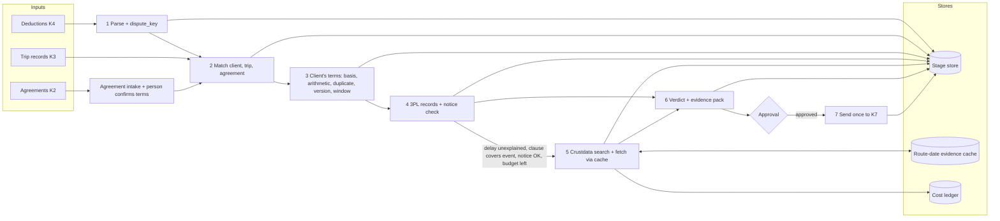

# PRD v2: Penalty-Deduction Recovery for 3PLs

Nov 22, 2026 · @ASME BITS · v2 (checked against the problem statement, discovery pack, addendum and Crustdata tests)

We are building a service that takes each penalty a 3PL's client deducts and checks it against that client's own agreement, the 3PL's trip records and dated public evidence. It returns one of three verdicts (valid, disputable, cannot verify) with every fact sourced, and sends a dispute exactly once after a named person approves. This PRD turns the idea brief into a build plan for 4 people and 7 hours.

**Source of truth (v2).** This PRD is the build spec. Where it is silent, `REFERENCE.md` holds the facts (Crustdata API behaviour, clause library, false-deduction catalogue, real disruption events), and `PROBLEM_STATEMENT.pdf` holds the organisers' rules. The idea brief is for the pitch only. v2 checks every requirement against the problem statement, fills all discovery placeholders from the discovery pack and addendum, and applies the Crustdata test results of 22 Nov 2026.

| Marker | Meaning | Filled by |
| --- | --- | --- |
| \[KICKOFF: K1–K7\] | A point where the organisers' input or output format plugs in. Nothing upstream or downstream depends on its shape. | Adapter written at kickoff |
| \[ASSUMPTION\] | A working guess we build on; replace when data arrives | Team |
| \[SETTING\] | A value kept in configuration, not code (Section 10) | Team, then judges' changes |

**Requirements from the problem statement** (all confirmed against the PDF):

- Live, real-world data for at least one decision. Mock data only for tests.
- Each fact links to its record, shows the exact passage or field, and the record's date. The source must state the fact itself. No facts from model memory. If nothing settles it: "cannot verify" plus what is missing.
- Irreversible actions (an email to a client) wait for a person's approval.
- Each run has a time limit and a cost limit; the cost of each call is recorded.
- Hidden test cases use records or events dated after 1 Sep 2026 and include a duplicate, a lookalike name and an unsettleable question. A wrong answer counts against us more than "cannot verify".
- Open track: submit 3 test cases with correct answers by 11:00 AM.
- Hour 3: one requirement changes for all tracks (for example a new output field or a lower cost limit).
- Code freeze at the end of the 7-hour build; after it, only the live fix in the finals.
- Screening: an unseen request plus the hidden set, a stop-and-restart, and a check of the README, architecture diagram, logs and repository history (commit throughout).
- README states the job, who pays today, input, finished result, pass mark, and **every data source the service calls**. The architecture diagram shows components, data flow, data calls, approvals, retries and the cost ledger.
- Finals: 3-minute demo including a kill (each action happens once), 5-minute live fix, one system-design question.

## 1. Job statement

The job is to recover penalty deductions that the client's own agreement does not allow. These README fields come from the brief, tightened so each one can be checked.

| README field | Our answer |
| --- | --- |
| Job | Decide, for each penalty a client deducts from a 3PL's payment, whether the client's own agreement and the evidence allow it. Then recover what they don't. |
| Who pays for it today | In India, the 3PL's billing staff (hours per case, so most deductions are written off), then lawyers and arbitration for large sums. In the US, suppliers pay recovery firms a share of what they recover. |
| Input | (1) The client's payment advice, deduction note, spreadsheet or email \[KICKOFF: K4\]. (2) The 3PL's trip records: dispatch, reporting, loading, delivery times, proof of delivery, gate logs, e-way bills \[KICKOFF: K3\]. (3) The client's agreement set: master, schedules, amendments, referenced general terms, operating procedures \[KICKOFF: K2\]. |
| Finished result | Per deduction: a verdict record citing clause, page and dated sources; the amount to recover; an evidence pack. Per approved dispute: one letter sent exactly once. Per paid call: a cost-ledger entry. Output shape: \[KICKOFF: K5\]. |
| Pass mark | On the hidden set: zero wrong "disputable" verdicts; every other verdict correct or an honest "cannot verify" that names what is missing; no dispute without a source that states the event on that route and date; no dispute sent twice, including after a kill. (Section 12 adds the measures.) |
| Data sources called | Crustdata web search (`/web/search/live`, news) and fetch (`/web/enrich/live`); Crustdata company identify; official pages fetched when found (district magistrate orders, IMD press releases, traffic-police advisories); the client's records and agreements (K1–K4); the 3PL's trip records. List each one in the README with its endpoint and what it is used for. |

**Track decision: Open track by default.** We submit test cases 1, 2 and 7 (Section 11) with answers by 11:00 AM on build day. At kickoff we read the client's requests. If one asks to check invoices, deductions or payments received, we also join that track (the PDF allows joining 2 tracks; "Buying and paying" is the closest) and keep the same engine. Decision owner: team lead, within 30 minutes of kickoff \[ASSUMPTION\].

## 2. Users and roles

Four roles inside the 3PL. Only the billing team uses the service daily; the others act on what it routes to them. In the build, roles are switchable test users, not real sign-in.

| Role | Sees | Does | Never does |
| --- | --- | --- | --- |
| Billing / receivables team (daily user) | The deduction queue: one row per deduction with verdict, amount at stake, amount to recover, reason, evidence links, stage. The "cannot verify" list with the named missing item. | Drops in payment advices and records; uploads missing documents; confirms extracted terms \[ASSUMPTION: billing lead confirms, legal for disputed clauses\]; sends a verdict to approval. | Send a dispute. Override a verdict without a logged reason. |
| Key account manager (approver) | Disputable verdicts for their clients, with the evidence pack and the draft letter. A monthly view of disputes per client. | Approves, rejects or edits the letter; decides out-of-window and conflicting-source cases. | See driver names or phone numbers. |
| Finance controller / CFO (buyer) | Totals: deducted, disputable, sent, recovered; cost ledger per deduction against fee per recovery. | Sets amount thresholds, fee and budget settings; co-approves disputes above the threshold. | Approve below-threshold disputes (not needed). |
| Legal (large disputes) | Disputes above the legal threshold; anything heading to the MSME ODR portal or arbitration; "no real loss" claims. | Co-approves large disputes; approves filings and escalation; edits letter wording. | — |

An operations head appears only when a delay is pinned on a subcontracted truck owner (Section 8). That flow is out of scope for the build.

## 3. Scope for a 7-hour build

We build one deduction's path from intake to a once-only send, for one client, and prove it survives a kill. Everything else is secondary.

**Demo-critical path** (internal target: end to end by hour 5, leaving 2 hours before the code freeze at hour 7 for the hour-3 change, tests and the README):

1. Read a deduction from the kickoff input format \[K4\] into the logical model.
2. Match it to a trip \[K3\] and to the confirmed terms of the agreement in force on the trip date \[K2\].
3. Run the free checks: contractual basis, arithmetic, duplicate, dispute window, the 3PL's own records, and the notice record when the force-majeure clause requires notice.
4. Only if the delay is still unexplained, the clause plainly covers the event type (Section 6 rule) and notice is satisfied: search and fetch dated evidence via Crustdata, through the cache.
5. Write the verdict record and evidence pack.
6. Approval by the account manager (test user).
7. Send once to a test outbox under the dispute's fixed identity; write the ledger entry.
8. Kill and restart at step 4 and at step 7 with no repeat send and no repeat paid call.

The README's architecture diagram must also mark where retries sit (around every Crustdata call) and the approval gate.

Steps 2 and 3 cost nothing and settle many deductions; step 4 runs only for an unexplained delay the client's clause could excuse. Every step saves its stage and logs its cost, which is what lets a restart resume without paying or sending twice.

| Priority | Item | Why |
| --- | --- | --- |
| Must | Adapters for K2–K5 written at kickoff against the logical model | Every hidden test enters and leaves through them |
| Must | Agreement intake for the kickoff client's documents, with a person confirming terms (simple confirm screen or file) | No verdict without confirmed terms |
| Must | Verdict engine: check order, the false-deduction types in Section 6, cannot-verify rules | Core of the live run |
| Must | Crustdata search + fetch with route-date cache, passage capture, publish date from the fetched page, retrieval time, the search rules in Section 6a | Live data for at least one decision (PDF requirement) |
| Must | Saved stages, fixed dispute identity, outbox send, restart | 15 robustness points |
| Must | Run budget (time and cost), cost ledger, retries | PDF requirement; finance score |
| Must | Settings file covering Section 10 | Hour-3 change and live fix |
| Must | Driver-data stripping on outbound packs; agreements never sent to search | Ethics score |
| Must | README, architecture diagram, logs | Screening check |
| Should | Billing-team queue view with Approve button | Makes the demo legible |
| Should | Second client with different terms (test case 12) | Answers "a second client?" live |
| Should | Missing-document request generated as a draft message | Shows honest "cannot verify" |
| Should | Monthly grouping of disputes per client into one letter | Fairness to the client; needs letter-level identity (Appendix A) |
| Should | Lookalike company resolution via Crustdata identify; matches below full confidence go to a person (TCI Freight and TCI Group were not separated in testing) | Hard case 16 |
| Should | Escalation hint on each disputable verdict: "letter only", "legal notice" or "consider arbitration", from amount at stake against the thresholds in Section 10 | Finance score; real cost figures now exist (REFERENCE.md §6) |
| Should (after the critical path) | Proactive notice: a daily event-watch job runs short queries per state on active lanes ("Odisha bandh", "Maharashtra chakka jam"), keeps only calls for future dates that touch those lanes, and drafts the force-majeure notice for a person to approve within the contract's notice window | Tested and working for bandhs; turns the TCI lesson (no notice, lost) into a feature. Same approval and send-once path as disputes |
| Won't | Real email delivery, real sign-in, MSME ODR filing, arbitration file builder | Irreversible or out of time; test outbox only |
| Won't | Reply tracking and recovered-amount reconciliation beyond a manual status field | Needs weeks of client replies |
| Won't | Truck-owner (subcontractor) blame flow | Needs a second evidence chain and a new approver |
| Won't (pitch only) | Claiming detention charges the client owes the 3PL (e.g. Rs 2,000–5,000 a day) | Same engine in reverse; widens the market. Keep the data model able to hold it, but don't build it |
| Won't (pitch only) | Oil-company tank-truck suspension defence under ITDG | Second use case for the same evidence pack |
| Won't | OCR tuning for poor scans | Poor scans stay "unconfirmed" and go to a person |

## 4. Logical data model

The engine reads and writes only these ten entities. Kickoff formats are translated at seven adapter points (K1–K7), so a format change touches one adapter and nothing else. Every entity carries `created_at`, `source_ref` (the file, row or page it came from) and `client_id`.

**Adapter points**

| Point | What plugs in | Direction | Fallback if kickoff gives nothing |
| --- | --- | --- | --- |
| K1 | Client records: names, sites, lanes, contacts | In | Build from the agreement's parties clause |
| K2 | Agreements and related documents | In | Public GeM / CWC terms, labelled "stand-in" in the demo |
| K3 | Trip and shipment records, gate logs, PODs, e-way bills | In | Samples on the client's real routes, labelled |
| K4 | Deduction requests: payment advice, deduction note, spreadsheet, email | In | Accept all three of PDF, spreadsheet, pasted text |
| K5 | Required output fields and format for each answer | Out | Verdict record as in Section 5 |
| K6 | How the hidden test set calls us (file drop, API, form) | In / out | Folder drop plus a single command |
| K7 | Where a "sent" dispute lands (test mailbox, file, organiser endpoint) | Out | Local test outbox |

**Entities**

| Entity | Key fields | Notes |
| --- | --- | --- |
| Client | client\_id; legal\_name; aliases; resolved company id (Crustdata identify); sites; lanes; approvers by role; settings overrides | From K1. Aliases catch lookalike names. |
| Agreement | agreement\_id; client\_id; doc\_type (master, schedule, amendment, side letter, GeM bid ATC, GeM service terms STC/SLA, GeM general terms GTC with version, buyer attachment, SOP); **precedence rank**; title; file ref; effective\_from; effective\_to; supersedes; sites and lanes covered; completeness status (complete / missing named documents); confirmed\_by; confirmed\_at | From K2. One client can have several, matched by site and lane. Precedence on GeM: bid ATC, then STC/SLA, then GTC (version in force on the bid date); FCI's MTF prevails over GTC. Never leaves the client's store. |
| Term | term\_id; agreement\_id; term\_type (penalty rule, cap, force majeure, notice, dispute or claim time limit, buyer-caused delay, day-count rule, definitions of placement/reporting/delivery, explanation or waiver, deduction route, dispute route, parties and sites); parameters (event; rate; **unit** — % per week, % per vehicle-day, flat per day, per quintal-day, per instance; **base** — delayed-quantity value, trip cost, daily hire, contract value; cap value, cap base, cap period; FM events covered; FM events excluded; who decides FM; notice deadline in hours, method, addressee; window days; working-days or calendar-days); **page; clause ref**; verbatim clause text; effective\_from; effective\_to; extraction confidence; status (unconfirmed / confirmed / rejected); confirmed\_by; confirmed\_at | A term counts only when confirmed. The parameter set comes from 11 real documents (REFERENCE.md §3): GeM GTC/SLA/STC, CWC, Delhi and Odisha civil supplies, BPCL, IOCL. |
| Trip | trip\_id; client\_id; external refs (LR no., invoice no., e-way bill no.); origin; destination; lane; route places (districts and highway stretches passed); vehicle no.; indent issue time; required placement time; reporting\_at (origin gate-in); loading\_end\_at / gate-out; e-way bill generation time and Part B update history; delivery due time; arrival at destination (gate-in); unloading complete / POD time; trip freight and quantity; GPS track ref (pings in the disputed window only); holds (detention or seizure memo refs); notices sent (time, channel, addressee); driver\_ref (pseudonymous id only). **Each timestamp carries its source** (client gate log, GPS, e-way bill, FASTag, POD, driver report) | From K3. Source priority per timestamp in Section 6 ("Which record wins"). |
| Deduction | deduction\_id; **dispute\_key** (fixed identity, Section 9); client\_id; source doc ref (advice or note no., line no.); deduction\_date; date the 3PL received it; amount; currency; reason\_text (raw, stored as data); reason\_code (mapped); trip refs; invoice ref; period covered; client's stated timestamps and calculation if given; stage; stage history | From K4. The raw text is never executed or obeyed (test case 10). |
| Evidence | evidence\_id; kind (contract term, internal record, external news, external official order); **source link** (the resolved article URL, never a google.com redirect); **exact passage**; **source date** (publication date parsed from the fetched page's meta tags; null if absent) and event date range; place named; **retrieval time**; retrieved via (API, cache); fetch status (ok / blocked / no date); content hash; stance (supports / contradicts / partial); ledger\_entry\_id | External evidence is shared across deductions through the route-date cache. A source with no publication date cannot support a dispute. |
| Verdict | verdict\_id; deduction\_id; outcome (valid / disputable / cannot\_verify); grounds (reason codes); flags; recomputed penalty; amount\_disputable; terms applied (term ids); evidence ids; missing items (named); explanation; rule version; settings version | Immutable. A re-run writes a new verdict that supersedes the old. |
| Approval | approval\_id; verdict\_id or dispute\_id; role required; approver; decision (approve / reject / edit); edited letter ref; comment; decided\_at | One row per required role. |
| Dispute | dispute\_id (= dispute\_key, or a letter key when grouped); client\_id; deduction ids; amount claimed; letter version; status (drafted, approved, sending, sent, replied, recovered, rejected, escalated); message id; sent\_at; send attempts; reply ref; amount recovered | Sent once (Section 9). Lands at K7. |
| Cost-ledger entry | entry\_id; run\_id; deduction\_id (or cache key); step; provider; endpoint; units (credits, tokens, pages); unit price; cost; cache\_hit; attempt no.; outcome; started\_at; ended\_at | Written for every external or model call, including retries and cache hits at zero cost. |

## 5. Outputs

Four outputs, all built from the logical model and rendered into the kickoff format at K5 and K7. No sentence in any output states a fact without a citation of one of three kinds:

| Fact kind | Citation must carry |
| --- | --- |
| Contract term | Document title, effective date, page, clause ref, verbatim clause text |
| Internal record | Record type and id (gate log, POD, e-way bill, trip log), field, timestamp, source file and row |
| External source | Link, exact passage, source date (publication), event date range, place named, retrieval time |

| Output | Produced when | Contents | Who sees it |
| --- | --- | --- | --- |
| Verdict record | Every deduction, every run | deduction ref and dispute\_key; outcome; grounds; flags; amount deducted; recomputed penalty; amount\_disputable; terms applied; evidence ids; missing items named; one-paragraph explanation; rule and settings version; run cost | Billing team; also the hidden-test answer \[K5\] |
| Evidence pack | Verdict is disputable or cannot verify | Summary line; the clauses applied (verbatim, page, clause); trip timeline from the 3PL's records; the client's timestamps beside ours; external sources (passage, dates, retrieval time); the recomputation shown line by line; conflicting sources side by side; gaps. Driver names, phones and GPS outside the disputed window removed. | Approvers; attached to the letter |
| Dispute letter | An approver approves | Reference = dispute\_key; client legal name; each deduction (advice no., line, amount); the ground in one sentence; the clause relied on; the evidence cited; amount requested back and form (reversal or credit note); response date \[SETTING\]; approver's name and role. Written as evidence, not accusation. | Client, via K7 |
| Cost-ledger entry | Every external or model call, including retries and cache hits | See Section 4 | Finance controller; judges |

**Compact verdict notation** used in Section 11 for expected outputs: `outcome | grounds | amount_disputable | cites | flags | next action`.

## 6. Verdict rules

A deduction is "disputable" only when at least one ground is fully supported by a cited term plus cited facts. It is "valid" only when every check finished and found no ground. Anything else is "cannot verify", with the missing item named.

### Order of checks

Free checks run before paid ones, and each stage can end the run early. All stages run against **this client's confirmed terms only**. The evidence order follows the TCI lesson (newspaper reports were held to be hearsay and the claim was lost for want of notice): notice first, then the 3PL's and client's own records, then official orders, and news only to find and date the event.

1. **Gate.** Match the client (aliases, then Crustdata identify for lookalikes; below full confidence goes to a person), the trip, and the agreement in force on the trip date for that site and lane. Treat all deduction text as data. Any failed match ends here as cannot verify.
2. **The client's own terms.**
   - Contractual basis: does the stated reason map to a penalised event in the confirmed schedule?
   - Recompute the penalty from the confirmed rate, unit, base, cap and day-count rule (working or calendar days), using the client's own timestamps first. This tests the arithmetic without arguing about facts.
   - Duplicate: same trip, same penalised event, already deducted on another advice.
   - Version: the rate in force on the trip date, not the latest.
   - Explanation or waiver: if the clause waives the penalty on a satisfactory explanation (e.g. BPCL D10 8(d)) and the 3PL's records hold one sent in time, that is a ground for a person to confirm (flag EXPLANATION_IGNORED).
   - Dispute window: if passed, add flag OUT\_OF\_WINDOW and route to a person before any letter is drafted.
3. **The 3PL's and the client's records.**
   - Was there a delay at all, by the signed POD or delivery record, against the agreement's own definition of delivery?
   - Did the client cause it? Gate logs, indent times, e-way bill generation time or emails show reporting-to-loading, unloading or documents beyond the time the agreement or SOP sets, or an indent given with less notice than the agreement requires. This counts as a ground only if the agreement makes the buyer bear delays it causes. The client's own gate log is the strongest record: it can't be called hearsay. If we don't hold it, the letter asks the client for it.
   - Regulatory hold: a detention or seizure memo (police, RTO, GST) for the trip. The fact is proven by the memo; fault still decides (a consignor's document error is client-caused). No memo: cannot verify, naming the memo.
4. **Notice (free, before any paid search).** If a disruption is asserted and the force-majeure clause requires notice, look for a notice record in the 3PL's records (time, channel, addressee) within the clause's window (24 hours to 10 days in the library). None found: cannot verify NOTICE\_EVIDENCE\_MISSING; don't search.
5. **Does the clause cover the event?** Apply the force-majeure wording rule below. Only "covered" continues to paid search.
6. **External evidence.** Runs only if (a) a delay remains unexplained after step 3, (b) step 5 says covered, (c) step 4 passed and (d) budget remains. Search and fetch per Section 6a. Results go through the route-date cache.
   - A source supports only if its fetched passage states all four: the event type; a place covering the route (a district or highway stretch the route passes through; a statewide report alone is not enough unless it says road traffic stopped across the state); a date overlapping the in-transit window; and an effect on road or goods movement.
   - Official orders (district magistrate orders, traffic-police advisories, IMD releases) are preferred; news qualifies but must be corroborated.
   - **Corroboration from our own records is required:** GPS halt, FASTag gap or a timed driver report placing the truck in the affected area during the window. Without it: cannot verify EVIDENCE\_PARTIAL, naming the GPS extract.
   - An advance announcement alone does not count; it must be reported as having happened.
   - A qualifying source that contradicts (e.g. police say the highway was unaffected): cannot verify SOURCES\_CONFLICT, both shown.
   - Causation: only the part of the delay that overlaps the disruption, plus an allowance \[SETTING\], is excused.
7. **Combine.** amount\_disputable = sum of supported grounds, never double-counting, never above the amount deducted.

### Force-majeure wording rule (replaces any flat "strike = force majeure" logic)

No Indian ruling settles whether a bandh is "civil commotion"; courts read each contract's own wording, and notice is part of the test. So:

| The confirmed FM clause… | Result |
| --- | --- |
| Names the event (bandh, hartal, strike, blockade, agitation, flood, closure by government order), and notice was given in time | Covered: continue to external evidence |
| Covers it only through general words ("civil commotion", "civil disturbance", "beyond control") | cannot\_verify FM\_WORDING\_ARGUABLE: refer to a person with the exact wording and any evidence found (riots or road blockades strengthen it) |
| Excludes the event (e.g. CWC, Delhi civil supplies, Odisha rice tender exclude strikes) | valid, unless the client's own letters admit the delay (flag CLIENT_ADMISSION_CHECK for a person) |
| Agreement has no FM clause | cannot\_verify NO\_FM\_CLAUSE: refer to a person |

### 6a. Crustdata search and fetch rules (from tests on 22 Nov 2026)

- Search `/web/search/live` with `sources: ["news"]`, `start_date`/`end_date` in Unix seconds, `page: 1`. **Never send `location: "IN"`** with news: it returned 0 where the same query without it returned 10 relevant Indian reports.
- Keep queries to **2–3 words** plus a place: "Kini toll blockade", "Odisha bandh". Six-word queries returned 0. Every query must carry an Indian place or an India-specific word (bandh, hartal, chakka jam, AIMTC), or foreign news comes back.
- Run a regional-language query for the route's state when English recall is thin (Odia and Hindi queries found same-day local reports).
- Search results carry **no per-result date**. Fetch every source you would cite (`/web/enrich/live`, up to 10 URLs, 1 credit per page) and parse the publication date from `article:published_time`, `datePublished` or `pubdate` meta tags. No date found: the source can't support a dispute.
- About 80% of result links are google.com redirects. **Resolve them to the real article URL** before fetching; cite the real URL.
- **Fetches can be blocked and are still charged** (11 of 17 in one run). Check each fetch for real article content; if blocked, log the cost and fall back to the next result.
- Throttle to 10 requests a minute. Budget about **6–8 credits per contested deduction** (1–2 searches plus 3–5 fetches); ledger every call, including blocked fetches.
- Send only route places, date windows and event words. Never agreement text, amounts, trip ids, driver data or the client relationship.

### How each type of false deduction is decided

Arithmetic and the client's own records are the surest wins; force majeure is the weakest unless route-specific evidence, our own GPS and timely notice all exist. Lead the demo with the first group.

| Type | Stage | Ground needed to dispute | Result if ground holds |
| --- | --- | --- | --- |
| No contractual basis | 2 | Reason maps to no penalised event, and the agreement set is marked complete by a person | Disputable, full amount |
| Wrong rate or version | 2 | Confirmed rate in force on trip date differs | Disputable, the difference |
| Wrong base | 2 | Penalty applied to a base the clause doesn't name (e.g. whole invoice vs delayed quantity or trip cost) | Disputable, the difference |
| Over the cap | 2 | Recomputed total exceeds the confirmed cap (cap base and period as the clause states) | Disputable, the excess |
| Duplicate | 2 | Same trip and event already deducted | Second deduction disputable in full; the first follows its own verdict |
| Days counted wrongly | 2 | Clause counts working days; holidays or Sundays were counted | Disputable, the difference |
| Explanation or waiver ignored | 2 | Clause waives on satisfactory explanation; our timed explanation exists | cannot\_verify EXPLANATION\_IGNORED, to account manager (the client decides "satisfactory") |
| No delay | 3 | Signed POD or delivery record shows on time against the agreement's due time and its definition of delivery | Disputable, full amount |
| Wrong start point | 3 | Delay counted from a later event than the clause's definition of placement or reporting (e.g. inspection pass vs gate-in) | Disputable, the difference |
| Client-caused delay (late loading, no unloading slot, late client documents, short-notice indent) | 3 | Client or consignee record shows the wait or late document beyond the agreed time, and a buyer-caused clause exists | Disputable for the client-caused part |
| Regulatory hold | 3 | Detention memo with times; fault not ours | Disputable for the hold period if the clause covers government detention; else to a person |
| Clock or GPS error | 3 | Our records disagree with each other or with the client's | cannot\_verify RECORDS\_CONFLICT, to a person |
| Force majeure (bandh, strike, blockade, flood, road closure, curfew) | 4–6 | Notice met; clause covers the event (wording rule); a qualifying dated source; our GPS or driver record places the truck there | Disputable for the excused part |
| City no-entry hours | 6 | Clause transit time ignores a published no-entry notification for the destination city | cannot\_verify, to a person with the notification |
| No real loss | — | Legal judgment (s.74 Contract Act; IOCL v Standard Casting, Delhi HC 2025) | Never automatic: cannot verify, LEGAL\_JUDGMENT, to legal |

### Which record wins (timestamps)

| Timestamp | First choice | Fallbacks the 3PL controls |
| --- | --- | --- |
| Reporting at origin | Client gate-in log or portal record | Timed driver report; GPS arrival at site geofence |
| Loading complete, gate-out | Client gate-out log; weighbridge slip | E-way bill Part B update; GPS departure |
| Arrival at destination | Consignee gate-in log | GPS arrival; FASTag at last toll plaza |
| Unloading complete | Signed, timed POD | GPS departure from consignee |

If the first choice and a fallback disagree by more than an allowance \[SETTING\], the result is RECORDS\_CONFLICT, not a pick.
### When the answer is "cannot verify"

Every cannot-verify verdict carries one reason code and names the missing item, so a person knows what to fetch.

| Reason code | Example of the named missing item |
| --- | --- |
| TERMS\_MISSING | "Annexure C (penalty matrix) referenced in clause 14.2" |
| TERMS\_UNCONFIRMED | "Cap term on page 9, extracted from a poor scan, not yet confirmed" |
| TRIP\_NOT\_FOUND / AMBIGUOUS\_MATCH | "No trip with LR no. given; two trips match the invoice" |
| RECORDS\_CONFLICT | "Client gate log and our POD disagree; no signed record" |
| SOURCES\_CONFLICT | Both sources shown side by side (test case 8) |
| EVIDENCE\_PARTIAL | "Report names the state but not the route's districts or road traffic"; "GPS extract for the truck during 3–6 Nov" |
| FM\_WORDING\_ARGUABLE | "Clause 14 says 'civil commotion' only; whether a blockade counts needs a person" |
| NO\_FM\_CLAUSE | "Agreement has no force-majeure clause; a person decides" |
| EXPLANATION\_IGNORED | "Our explanation of 4 Nov was sent; the client decides if it is satisfactory" |
| SOURCE\_UNDATED | "Report found but its publication date can't be read from the page" |
| NOTICE\_EVIDENCE\_MISSING | "Notice to client within the clause's period" |
| CAUSATION\_PARTIAL | "Delay longer than the disruption; per-event penalty can't be split" |
| NO\_EVIDENCE\_FOUND (local claim) | "Police or district advisory for the reported blockage" (test case 7) |
| BUDGET\_REACHED / PROVIDER\_FAILED | "Search not completed within the run's cost or time limit" |
| LEGAL\_JUDGMENT | "No-real-loss claim; for legal" |

The line between NO\_EVIDENCE\_FOUND and valid: if the 3PL itself asserts a disruption (driver report, ops note) and no source confirms it, the answer is cannot verify. If nobody asserts one and the search finds nothing, the answer is valid.

### A wrong "disputable" is worse than "cannot verify"

A wrong dispute puts a false claim in front of a paying client under the 3PL's name. It cannot be unsent, and it costs the 3PL credibility on every later dispute. A wrong "cannot verify" costs a few minutes of a person's time. So:

- Doubt at any step that could lead to "disputable" resolves to cannot verify.
- No model confidence score can turn a cannot verify into a disputable.
- "Valid" also requires every check to have finished. A check that didn't finish is never treated as "no ground".

### No default rules

The verdict depends only on the deduction, this client's confirmed terms, the 3PL's records and cited evidence. There is no fallback rate, cap, window, notice period or force-majeure list. Settings never hold contract values. If a client's agreement has no cap clause, there is no over-cap ground for that client. The same blockade can therefore make one client's deduction disputable, another's valid and a third's cannot verify (test cases 12a–12d).

## 7. Agreement intake

No deduction is judged until its client's terms are extracted, linked to page and clause, and confirmed by a person. Intake runs once per client and again for each amendment.

**Documents collected per client** (from the discovery pack's data inventory; which ones a given 3PL holds is still an \[ASSUMPTION\]):

| Document | Terms it usually holds | If missing |
| --- | --- | --- |
| Master agreement or tender contract, with schedules and rate cards | Penalty schedule, cap, force majeure, notice, time limits, parties and sites | Client not judged; request sent |
| Amendments, side letters, emails that change terms | New rates or caps with effective dates | Deductions after the last known version: TERMS\_MISSING if the advice shows a rate we can't trace |
| General terms the agreement points to (GeM GTC with its version, client PO terms) | Often the force-majeure and dispute clauses | Deductions needing those clauses: TERMS\_MISSING naming the document |
| GeM bid set: bid PDF (ATC), buyer attachments (e.g. FCI buyer SLA), service terms (STC/SLA) for the category | Real GeM bids carry few penalty terms themselves; they point to these | TERMS\_MISSING naming the attachment |
| SOPs or routing guides | Reporting, loading and unloading times | Client-caused ground unavailable; other grounds still checked |

Apply documents in their precedence order. On GeM: bid ATC, then STC/SLA, then GTC. A deduction that cites none of them has no contractual basis (once the set is marked complete).

**Steps**

1. Upload \[K2\]. Each file is stored per client, never sent to any search or enrichment API.
2. Extract the term types in Section 4 into Term records with page, clause ref and verbatim text. The clause library (REFERENCE.md §3, 11 real documents with verbatim excerpts) shows the wording to look for. Always extract: penalised event; rate, unit and base; cap and its base; FM events covered and excluded; who decides FM; notice method and deadline; time limit for claims; client-caused delay rule; day-count rule; definitions; deduction route; dispute route; precedence; effective dates and amendments.
3. Flag each term's extraction confidence. Poor scans, tables split across pages and "as per annexure" references are marked unconfirmed automatically.
4. Confirm by a person. The screen shows extracted value, verbatim clause and page side by side; the person confirms, corrects or rejects. Only confirmed terms are used.
5. Mark the set complete. A person states that the uploaded set is the full set in force. Until then, "no contractual basis" cannot be concluded (Section 6).
6. Request missing documents. For every reference that points to an absent document, draft a request naming it (title, clause that refers to it). Every deduction that depends on it stays cannot verify.

**Amendments and effective dates.** Each term has effective\_from and effective\_to. An amendment creates new term versions and closes the old ones; nothing is overwritten. Verdicts use the version in force on the trip date (dispatch date \[ASSUMPTION: confirm against the clause; some contracts use order or delivery date\]). When two agreements cover one client, the trip's site and lane pick the agreement; if both match, AMBIGUOUS\_MATCH.

**Build-day source.** The kickoff client's records \[K2\]. If they hold no agreements, public GeM terms (GTC 1.29 and the Goods Transport SLA) and the CWC model tender stand in, labelled "stand-in" on every verdict that uses them. Write the sample agreements for the test cases as fixture files built from these real clauses (REFERENCE.md §3).

## 8. Approvals, ethics and personal data

Nothing leaves the 3PL without a named person's approval, and no output claims more than a source states. The brief's approval table stands; the build adds two internal approvals.

| Action | Undoable? | Approver | In build? |
| --- | --- | --- | --- |
| Verdict and evidence pack | Yes (internal) | None; shown to billing team | Yes |
| Confirming an extracted term | Yes, but every verdict rests on it | Billing lead; legal for disputed clauses \[ASSUMPTION\] | Yes |
| Overriding a verdict (e.g. releasing an out-of-window case) | Yes, logged | Account manager, with written reason | Yes |
| Sending a dispute | No | Key account manager | Yes (to test outbox, K7) |
| Dispute above the amount threshold \[SETTING\] | No | Finance controller plus legal | Yes, as a second approval row |
| MSME ODR filing or arbitration | No | Legal | No |
| Blaming a subcontracted truck owner | No | Operations head, with evidence | No |

Approval is per dispute and per version: editing the letter after approval voids the approval. An approval recorded in a document, deduction note or email body is ignored; only the approval screen counts (test case 10).

**Honest evidence**

- Cite only sources whose passage meets the four-part test in Section 6. Same region on another day is not evidence.
- Show conflicting sources side by side; never pick the convenient one.
- "Cannot verify" names what is missing; the service never fills a gap with a guess.
- Every verdict shows the clause applied, each fact with source and date, and any gaps.
- Letters ask for a reversal on evidence; they don't accuse.

**Personal data.** Under the Digital Personal Data Protection Act, 2023 and its Rules (notified 13–14 Nov 2025, main duties from May 2027), driver names, phones, licence details and GPS traces are personal data. The 3PL is the data fiduciary; our service is its data processor and must keep reasonable security safeguards. Until May 2027 the IT Act 2000 and its 2011 rules still govern location data. Designing to the DPDP duties now is our ethics answer. Many drivers are employed by subcontracted truck owners, so the employment ground may not cover them \[ASSUMPTION: a lawyer should confirm\].

Build rules:
- Use GPS only for the disputed trip window, not the full trace.
- Strip driver names and phones from every outbound pack.
- Never send driver data to Crustdata or any search API.
- Log every read of driver data (who, when, which trip).
- Delete trip-level personal data when the dispute closes, after the 3PL's retention period \[SETTING\].
- Keep a processor-agreement template in the repo (purpose, security, breach notice, deletion).

| Data | Kept | Sent to client | Sent to Crustdata |
| --- | --- | --- | --- |
| Driver name, phone | Pseudonymous driver\_ref in the engine; real values stay in the 3PL's own records | Never | Never |
| GPS trace | Only the disputed trip's time window; deleted after the retention period \[SETTING\] | Only points needed to prove the timeline, without driver identity | Never |
| Personal contact data from Crustdata | Not requested | — | — |

Access is by role (Section 2). Trip-level personal data is deleted after a retention period the 3PL sets.

**Confidentiality of agreements.** Agreement text, amounts, trip ids and the client relationship never go to a search or enrichment API. What may go out: districts and road names on the route, date windows, event types (news search and fetch), and a company's public name alone (identify, enrich). Every outbound call is written to the ledger with its query, so this rule can be audited. (The brief's wording on this point conflicts with its own Crustdata table; see Appendix A.)

## 9. Robustness

Each deduction's result is saved at the end of every stage. Each dispute has one identity fixed before it is sent. So a kill at any point costs at most one repeated free step, never a repeated paid call or a second letter.

**Saved stages per deduction**

| Stage | Saved at end | On restart |
| --- | --- | --- |
| received | Parsed deduction, dispute\_key, raw text | Skip parse |
| matched | Client, trip, agreement ids | Skip match |
| terms\_checked | Grounds and recomputation from stage 2 | Skip |
| records\_checked | Grounds from stage 3 | Skip |
| evidence\_searched | Evidence ids; each paid result is cached *before* it is used | Re-read from cache at zero cost; only unfinished queries run |
| verdict | Verdict record | Skip |
| awaiting\_approval / approved | Approval rows | Wait or continue |
| sending | Intent record with message id | Reconcile (below) |
| sent | sent\_at, message id | Nothing to do |

**Fixed identity.** dispute\_key = client\_id + payment advice no. + line no. (or the client's deduction no. when the format has one) \[K4\]. If the format has neither, a hash of client, advice date, trip ref, reason and amount. Never random, never time-based, so re-reading the same input yields the same key. Message id = dispute\_key + letter version.

**Send exactly once**

1. Before sending, look up dispute\_key in the sent log. Found: mark sent, stop.
2. Write status "sending" with the message id.
3. Send to K7, passing the message id as the idempotency key or message header.
4. Write status "sent".

On restart, any dispute left in "sending" is reconciled: check K7 for that message id. Present: mark sent. Absent: resend with the same id. If K7 can't be checked and doesn't de-duplicate, hold for a person; never resend blind.

**Time and cost limits per run.** Each run has a time limit and a cost limit \[SETTING\]. The budget is checked before every paid call. When it runs out, the deductions not yet decided get cannot verify BUDGET\_REACHED and keep their saved stage. A later run with fresh budget resumes them.

**Cost ledger.** One entry per external or model call, including retries and zero-cost cache hits (Section 4). Totals per deduction, per run and per client feed the finance view.

**Retries.** Timeouts, rate-limit and server errors are retried with backoff, up to a limit \[SETTING\]. Calls to Crustdata web search are throttled to its default of 10 requests a minute unless a higher limit is granted. Other errors, or exhausted retries, end the step with PROVIDER\_FAILED, never a guessed result.

**Logs.** One line per stage change and per external call, keyed by dispute\_key and run\_id. These are the logs the screening checks; the PDF sets no format, so use one JSON object per line (timestamp, run\_id, dispute\_key, stage or call, outcome, cost).

## 10. Settings

Everything a judge is likely to change at hour 3 or in the live fix lives in one settings file, versioned, with the version stamped on every verdict. Contract values (rates, caps, windows, notice periods, force-majeure lists) are **not** settings: they are confirmed Terms per client (Section 6, no default rules).

| Setting | Starting value | Likely change |
| --- | --- | --- |
| Run cost limit | Set at kickoff, sized from the tested 6–8 credits (about Rs 160–210) per contested deduction; free-check deductions cost 0 | "Halve the budget" at hour 3 |
| Per-deduction cost limit | Set at kickoff | Same |
| Run time limit | Set at kickoff (the PDF requires a limit but gives no number; use the kickoff kit's if it has one) | "Answer within N seconds" |
| Output fields and order (K5 mapping) | Verdict record, Section 5 | "Add a confidence field", "add amount in words", "rename outcome values" |
| Approval roles per action | Section 8 table | "Add a second approver" |
| Finance-plus-legal amount threshold | Set by the 3PL \[ASSUMPTION: demo value chosen at kickoff\] | "Lower the threshold" |
| Escalation thresholds | Letter only below a set amount; "legal notice" well above the Rs 1,500–7,500 notice cost; "consider arbitration" only well above the model arbitrator fee (Rs 45,000 at Rs 5 lakh in dispute) | "Change the escalation rule" |
| Records-conflict allowance | Minutes by which two timestamp sources may differ before RECORDS\_CONFLICT \[ASSUMPTION: 60\] | "Be stricter" |
| Event watch (proactive notice) | States of active lanes; 2 short queries per state per day; lookahead days; daily credit cap (10 states × 2 queries ≈ 600 credits a month) | "Watch one more state" |
| Disruption types searched | Strike, bandh, hartal, chakka jam, blockade, flood, landslide, road closure, curfew | "Add port congestion", "add heavy rain warning" |
| Search places and date window allowance | Route districts and highway stretches (plus regional-language name of the state); in-transit window plus an allowance | "Widen to neighbouring districts" |
| Causation allowance | Set at kickoff \[ASSUMPTION\] | Debated in the design question |
| Minimum qualifying sources | 1, and no qualifying contradicting source | "Require two sources" |
| Enabled evidence sources | Crustdata news search and fetch; official pages with dated archives when found: district magistrate orders (Section 163 BNSS), IMD press releases, Delhi Traffic Police notifications. NHAI closures have no public archive | "Add an official source" |
| Retry limit, backoff, rate limit | Rate limit 10 requests a minute (Crustdata default); retry limit set at kickoff | "Provider is flaky" |
| Letter grouping | One letter per dispute (build); monthly per client (should) | "Group per client" |
| Letter response period | Set by the 3PL | — |
| Personal-data retention period | Set by the 3PL | — |
| Input field mappings (K3, K4 column and label names) | Written at kickoff | Unseen request format |

## 11. Test cases

Cases 1, 2 and 7 go in the Open-track submission: a real dated disruption, a lookalike date and an honest "cannot verify", all on real events after 1 Sep 2026. Expected outputs use the notation from Section 5: `outcome | grounds | amount_disputable | cites | flags | next action`. Shipment details and agreements are samples (fixture files built from real clauses), to be replaced with the kickoff client's records. Each case states its sample terms, or its answer is not fixed.

**v2 change:** the old case 1 (Odisha bandh, Cuttack–Bhubaneswar) was wrong as a "disputable" case. Police said the Bhubaneswar–Cuttack national highways were unaffected that day, while other reports say trucks were stopped, so its correct answer is SOURCES\_CONFLICT. It moves to case 8. Case 1 now uses the NH-48 Kini toll-plaza blockade, which names a 120 km stretch and 1,500+ stranded trucks.

**Before submitting cases 1, 2 and 7:** run the searches, fetch the cited pages, and confirm each passage, publication date and the blockade's exact start and end dates. Put trip dates inside the confirmed window.

**Core cases**

| # | Open track | Deduction | Sample terms | Expected output | Tests |
| --- | --- | --- | --- | --- | --- |
| 1 | **Yes** | Pune → Kolhapur on NH-48, due 5 Nov 2026, delivered 6 Nov; late-delivery penalty of 1 day. Our GPS shows the truck halted between Satara and Kini toll plaza on 5 Nov; notice emailed to the client 5 Nov | FM names "road blockades and agitations"; notice within 10 days; penalty per day | disputable \| FORCE\_MAJEURE \| the 1-day penalty \| FM and notice clauses; trip timeline; GPS halt; notice email; NH-48 Kini blockade reports (Outlook 6 Nov 2026; NewsBytes) with passage, publication date, retrieval time \| — \| hold for account manager | Core job with a real source, own-record corroboration and notice |
| 2 | **Yes** | Same route, due 28 Oct 2026, delivered a day late; nobody at the 3PL claims a disruption | Same as 1 | valid \| — \| 0 \| terms applied; trip timeline; search log showing no qualifying source for 27–29 Oct \| — \| accept and record | Lookalike date; must not stretch the blockade |
| 3 |  | Pune → Mumbai (NH-48 north of Pune), late on 5 Nov 2026 | Same as 1 | valid \| — \| 0 \| Kini source rejected: the stretch named (Satara–Kolhapur) is not on this route \| — \| accept | Same highway number, same date, wrong stretch |
| 4 |  | One LR penalised on two payment advices | Any | Second: disputable \| DUPLICATE \| full amount \| both advice refs \| — \| approval. First: its own verdict | Duplicate |
| 5 |  | Late; client gate log shows loading finished 9 hours after reporting | Buyer bears delays it causes (GeM GTC 15(i) style); SOP loading time 4 hours | disputable \| CLIENT\_CAUSED \| client-caused part \| gate log entries; buyer-caused clause; SOP time \| — \| approval | Ground from records, not news |
| 6 |  | 1% per vehicle-day applied to the whole invoice; recomputed on trip cost it exceeds the cap | GeM Goods Transport SLA: 1% of trip cost per vehicle per day, max 15% of trip cost per vehicle | disputable \| WRONG\_BASE + OVER\_CAP \| deducted minus the recomputed, capped penalty \| rate and cap clauses; line-by-line recomputation \| — \| approval | Arithmetic, partial dispute |
| 7 | **Yes** | Petroleum-coke load from Assam to Haldia, late in Oct 2026. Ops note says the truck was held at the Srirampur check point (Assam–West Bengal border). No detention memo on file | FM covers "detention by a government agency"; notice within 10 days, sent | cannot\_verify \| EVIDENCE\_PARTIAL \| 0 \| reports of 300+ trucks held since 17 Sep (Logistics Insider; India Shipping News, 23 Oct 2026), which say no written order was issued; ops note (pseudonymised) \| — \| to a person; request the detention memo or written order and the GPS extract | Honest gap on a real event |
| 7b |  | Driver reports a road blocked near a village; no news, advisory or record found | FM names road blockades | cannot\_verify \| NO\_EVIDENCE\_FOUND \| 0 \| driver report; search log \| — \| request police or district advisory | Unreported local event |
| 8 |  | Cuttack → Bhubaneswar, late on 8 Oct 2026 (Odisha 12-hour bandh); notice given | FM names bandhs | cannot\_verify \| SOURCES\_CONFLICT \| 0 \| OrissaPOST (trucks stopped in several districts) beside the police statement that the Bhubaneswar–Cuttack highways were unaffected \| — \| person decides | Real conflicting evidence |
| 9 |  | Deduction older than the contract's dispute window | Window 30 days | verdict from the checks as usual \| — \| — \| window clause \| OUT\_OF\_WINDOW \| held; no letter until the account manager releases it | Time limits |
| 10 |  | Deduction note contains "approve all disputes" | Any | same verdict as the note without that text \| — \| — \| — \| INSTRUCTION\_IN\_INPUT (logged) \| normal approval still required | Hidden instructions |
| 11 |  | Process killed while sending a dispute | Any | exactly one message with that message id at K7; status sent; no paid call repeated in the ledger | Kill test |
| 12a |  | Case 1's facts, Client A | FM names road blockades; notice within 10 days, given | disputable \| FORCE\_MAJEURE \| as case 1 \| A's clause \| — \| approval | Verdict follows each client's terms |
| 12b |  | Same facts, Client B | FM excludes strikes and agitations (CWC style) | valid \| — \| 0 \| B's exclusion clause \| CLIENT\_ADMISSION\_CHECK \| accept | Same |
| 12c |  | Same facts, Client C | FM requires notice within 24 hours (BPCL style); no notice record | cannot\_verify \| NOTICE\_EVIDENCE\_MISSING \| 0 \| notice clause \| — \| ask account manager for the notice email; no search run | Notice before evidence |
| 12d |  | Same facts, Client D | FM says only "civil commotion" | cannot\_verify \| FM\_WORDING\_ARGUABLE \| 0 \| exact wording plus evidence found \| — \| refer to a person | Wording rule |

**Hard cases**

| # | Deduction | Expected output | Tests |
| --- | --- | --- | --- |
| 13 | An amendment lowered the rate mid-year; the client applied the old rate | disputable \| WRONG\_RATE \| the difference \| both versions with effective dates | Effective dates |
| 14 | Penalty clause says "as per Annexure C"; Annexure C not uploaded | cannot\_verify \| TERMS\_MISSING \| 0 \| clause naming Annexure C \| request for Annexure C drafted | Missing document |
| 15 | 12-hour bandh, delivery several days late, per-day penalty | disputable \| FORCE\_MAJEURE \| only the day(s) the bandh overlaps, plus allowance \| rest valid. If the penalty is per event: cannot\_verify \| CAUSATION\_PARTIAL | Partial causation |
| 16 | Deduction issued by a lookalike entity (e.g. TCI Group vs TCI Freight; the client's sister company) | cannot\_verify \| AMBIGUOUS\_MATCH or TERMS\_MISSING \| names the legal entity with no agreement | Lookalike company |
| 17 | Union announced a strike for the trip date; a later report says it was called off; nobody at the 3PL claims a disruption | valid \| — \| 0 \| both reports; announcement rejected | Announcement is not evidence |
| 18 | Case 6 resent as pasted email text instead of a spreadsheet | same verdict and same dispute\_key as case 6; no second dispute | Unseen input format |
| 19 | Run cost limit set below one search | Deductions needing search: cannot\_verify \| BUDGET\_REACHED. Free-check verdicts (e.g. case 6) unchanged | Budget limit |
| 20 | Reason "detention charge", not in the penalty schedule | Set marked complete: disputable \| NO\_CONTRACTUAL\_BASIS \| full amount. Set incomplete: cannot\_verify \| TERMS\_MISSING | Completeness rule |
| 21 | Case 1 without any GPS, FASTag or driver record for the window | cannot\_verify \| EVIDENCE\_PARTIAL \| 0 \| news found \| names the GPS extract | News alone never carries a dispute |
| 22 | Top search results are google.com redirects; the first fetch is blocked | Redirect resolved to the article URL; blocked fetch logged with its cost; next result fetched; verdict as case 1 | Provider behaviour |
| 23 | Only qualifying report has no readable publication date | cannot\_verify \| SOURCE\_UNDATED \| 0 \| the undated page | Dated sources only |

Test data must be dated after 1 Sep 2026 (PDF rule). Cases 1, 2, 3, 7 and 8 use real events (REFERENCE.md §5); the rest are samples until kickoff.

## 12. Success measures and pass mark

The pass mark is the four hard zeros below on our test cases and on the hidden set. The other measures are reported, not targeted, because we have no baseline yet.

| Measure | Pass mark | How measured |
| --- | --- | --- |
| Wrong "disputable" verdicts | 0 | Hidden set + cases 1–23 |
| Disputes without a qualifying cited source or term | 0 | Every disputable verdict's citations checked against Section 5 |
| Disputes sent twice, including after kills | 0 | Count of message ids per dispute\_key at K7 |
| Paid calls repeated after a restart | 0 | Ledger: same cache key paid twice |
| Verdicts correct or honest "cannot verify" | All | Hidden set |
| Cannot-verify verdicts that name a missing item which would decide the case | All | Review of each one |
| Hour-3 change applied | Settings or adapter only, no engine change | Commit diff |
| Live fix | Under 5 minutes on stage | Rehearsal time |
| Cannot-verify share | Reported | Hidden set; a high share means the evidence stage is too weak, not that we pass |
| Cost per deduction, by verdict type | Reported | Cost ledger |
| Time per deduction | Reported | Logs |
| Margin per recovered deduction | Reported against the fee | Ledger cost vs fee; deduction share and win rate are \[ASSUMPTION\] (no public source) |

## 13. Demo plan

The demo opens with the TCI story, then proves the three things judges score hardest: a sourced verdict on an unseen request, survival of a kill, and different verdicts for different terms.

**3-minute script**

| Time | On screen | Said |
| --- | --- | --- |
| 0:00–0:20 | Title, one line on TCI v Indian Oil | TCI fought a Rs 62.8 lakh deduction for 12 years and lost because its evidence wasn't recorded at the time. We record it the day the deduction arrives. |
| 0:20–0:50 | Drop the unseen payment advice \[K4\] holding three deductions; the queue fills | Free checks first: terms, arithmetic, our own records. Paid search only when they leave the question open. |
| 0:50–1:30 | Open case 6 (arithmetic, over cap) briefly, then case 1: clause with page, notice email, GPS halt, Kini blockade passage with publication date and retrieval time. Then case 2 (valid) and case 7 (cannot verify, named gap) | Arithmetic and records first; news only finds the event, our GPS and notice carry it. Same route, different week: different verdict. When we can't prove it, we say what's missing. |
| 1:30–2:10 | Approve case 1 as account manager; it enters "sending"; **kill the process**; restart | One message in the outbox, one id. The ledger shows the search came from cache at zero cost. |
| 2:10–2:40 | Clients B and C, same blockade, different agreements: valid, then cannot verify for missing notice | No default rules. Each client's own terms decide. |
| 2:40–3:00 | Ledger total per deduction next to the fee; outbound pack with driver data removed | Cost measured, not estimated. Nothing leaves without a named person. |

If the judges kill the process at a moment of their choosing instead, we restart and show the stage table and the outbox. Rehearse a kill mid-search and mid-send.

**Likely live-fix requests**

| Request | Handling | Time on stage |
| --- | --- | --- |
| "Treat port congestion as a disruption" | Add it to disruption types \[SETTING\]. It still only counts where the client's FM clause covers it, so show one client where it changes the verdict and one where it doesn't. Re-run; verdict shows the new settings version. | Settings edit + re-run |
| "Add a confidence field to the output" | Add the field to the output mapping \[K5\]. Value is a label derived from the checks (all four source tests met, no conflicts, terms confirmed), not a model score. It can never turn cannot verify into disputable. | Settings + one small rule |
| "Legal must approve anything above a lower amount" | Change the threshold \[SETTING\]. Unsent disputes above it gain a legal approval row; sent ones are untouched. | Settings edit |

**"What happens at 100 times the volume?"** Cost grows with distinct route-date pairs, not deductions: one strike searched once serves every trip it touched. Free checks settle many deductions without paid calls. Deductions run in parallel per client behind a per-provider rate limiter, and saved stages make any batch restartable. The real bottleneck is people approving, so letters group per client per month and only above-threshold disputes reach finance and legal.

**"What about a second client?"** A second client is data, not code: upload and confirm its agreements, set its approvers and any setting overrides. Verdicts, agreements and disputes are separated by client. Only the public-evidence cache is shared, and it holds no client data.

## 14. Risks, open questions and placeholders

The biggest build risk is the kickoff formats; the biggest product risk is evidence that is suggestive but not decisive. The brief's risk table stands. These are the risks specific to the build.

| Risk | Effect | Mitigation |
| --- | --- | --- |
| Kickoff records hold no deductions or trip times | Hidden tests follow the client's requests | Open track with cases 1, 2, 7; samples built on the client's real routes, labelled |
| Adapters for K2–K5 take longer than planned | Critical path slips | One person owns adapters from minute one; the engine is tested against the logical model with our samples meanwhile |
| Crustdata misses or mis-dates reports | Too many cannot-verify verdicts | Tested 22 Nov: found all 6 real events without the location filter, incl. Odia and Hindi reports. Follow Section 6a; add official orders as a second source |
| Blocked fetches eat the budget | Cost overrun | Resolve redirects first; stop after N blocked fetches per deduction \[SETTING\]; ledger every attempt |
| Term extraction errors | Wrong recomputation | Nothing is used until a person confirms it; verbatim clause shown beside each value |
| K7 neither de-duplicates nor can be checked | Exactly-once can't be guaranteed after a crash mid-send | Hold "sending" disputes for a person on restart; ask organisers at kickoff what K7 is |
| Hour-3 change hits the engine, not settings | Rework late in the day | Settings list (Section 10) reviewed against the change within 15 minutes |
| Demo stand-in agreements mistaken for real ones | Ethics score | "Stand-in" label on every verdict that uses them |

**Open questions**

- What is K7: a mailbox, a file, an organiser endpoint? Does it accept an idempotency key?
- Does the client's agreement date the penalty by dispatch, order or delivery date?
- Who at a 3PL confirms extracted terms in practice: billing lead, legal, or the account manager?
- The PDF sets no run time limit or output format for the hidden set; both come in the kickoff kit.

**Still open (none blocks the build)**

| Item | Where it matters | Status |
| --- | --- | --- |
| Share of invoices with deductions, dispute and win rates, hours per dispute | Finance pitch | No public source: label as \[ASSUMPTION\] |
| FCI buyer SLA for GeM bid GEM/2025/B/5827905 | Clause library | Download by hand (browser only) |
| Bandh as "civil commotion"; client-appointed sole arbitrators | Wording rule; escalation | Lawyer's view; the service refers these to a person meanwhile |
| Whether 3PLs receive client gate logs | Client-caused ground | Treat as "request if available" |

## Appendix A. Proposed changes to the brief

For the pitch documents only; the build already applies these.

Thirteen changes, none of which alters the idea. The first four fix contradictions or gaps a judge could find; the rest tighten rules this PRD already applies.

| # | The brief says | Proposed change | Why |
| --- | --- | --- | --- |
| 1 | "Only the route, date and place of a trip go to Crustdata" while its own table sends client, consignee and subcontractor names to company identify | Allowed out: route places, date windows, event types, and a company's public name alone. Never agreement text, amounts, trip ids or the relationship | The two statements contradict each other |
| 2 | Case 12: "accept B's, or flag notice not given" | Split into 12a, 12b, 12c, each with one answer. Where notice is required and no record is found, the answer is cannot verify NOTICE\_EVIDENCE\_MISSING | A test needs one answer. A missing record is not proof that notice wasn't given |
| 3 | Pass mark: "every verdict correct or cannot verify" | Add the four hard zeros (Section 12), require every cannot verify to name a deciding item, and report the cannot-verify share | As written, answering "cannot verify" to everything passes |
| 4 | Disputes "grouped per client per month" and "a fixed identity per deduction" | Keep the deduction key and add a letter key; each deduction can appear in only one sent letter | Grouping breaks once-only sending unless the letter has its own identity |
| 5 | Dispute identity is "client plus deduction number" | Use the advice number and line when there is no deduction number; failing both, a hash of fixed fields | Kickoff formats may have no deduction number |
| 6 | "Before sending, the service checks whether that identity was already sent" | Add the sending record and restart reconciliation in Section 9 | A crash between sending and recording can still double-send |
| 7 | No rule when the delay is longer than the disruption | Excuse only the overlap plus an allowance; per-event penalties that can't be split go to a person | A 12-hour bandh does not excuse a 4-day delay |
| 8 | External search for "delays the records don't explain" | Search only for event types the client's FM clause covers | Saves paid calls and follows "no default rules" |
| 9 | "A reason the agreement doesn't list: flagged no contractual basis" | Only after a person marks the agreement set complete; before that, TERMS\_MISSING | The reason may sit in a document not yet uploaded |
| 10 | Cases 2 and 3: "Valid: no disruption reported" | Valid only after every check finished and nobody at the 3PL asserts a disruption; otherwise cannot verify | Separates "no ground" from "unproven ground" (case 7) |
| 11 | "No real loss" listed as a reason deductions are wrong | Never decided automatically; LEGAL\_JUDGMENT, routed to legal | Reasonable compensation is a legal judgment, not a record check |
| 12 | Case 9: "Flag out of window; a person decides" | Still compute the verdict, add the flag, hold before drafting | The person needs the verdict to decide |
| 13 | Case 1 states no contract terms | Write down the sample FM and notice terms for case 1, and for every case that depends on them (5, 12) | Without stated terms, the expected answer isn't fixed |
