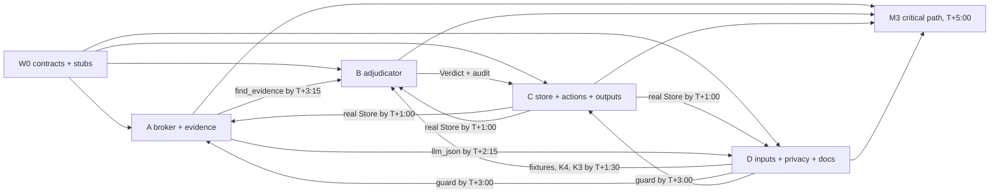

# WORKSTREAMS: four parallel lanes, task lists and the git workflow

**Version 2, 22 Nov 2026**, matching `DESIGN.md` version 2. `PLAN.md` gives the phases and timeline. This file splits the build so four people, or four coding agents, can work at once and merge without collisions. The contracts between lanes are in `INTERFACES.md`.

Each task is marked **M** (Must: on the critical path or on PLAN's never-cut list) or **S** (Should: first to be cut).

## 1. The split

Each lane owns one idea and a set of directories. Nobody edits another lane's files without asking; shared files are in Section 4.

| Lane | Owner (folder) | Owns the idea | Directories |
| --- | --- | --- | --- |
| **A** | Harsh (`harsh/`), also lead | **Everything that costs money**: the broker, Crustdata, the model adapter, the evidence scout | `pdr/broker/`, `pdr/evidence/`, `pdr/llm.py`, `pdr/prompts/`, `tests/fakes/`, `tests/cassettes/` |
| **B** | Gujju (`gujju/`) | **The adjudicator**: check registry, memoised pipeline, recomputation, combine, auditor | `pdr/engine/`, `tests/unit/engine/`, `tests/test_cases.py` |
| **C** | Jindal (`jindal/`) | **Everything that must happen once, and everything people see**: store, settings, actions, sending, outputs, case file, CLI | `pdr/store.py`, `pdr/schema.sql`, `pdr/settings.py`, `settings.yaml`, `pdr/log.py`, `pdr/crashpoints.py`, `pdr/actions.py`, `pdr/send.py`, `pdr/outputs/`, `pdr/adapters/k5_output.py`, `pdr/adapters/k7_outbox.py`, `pdr/cli.py`, `pdr/ui/`, `tests/test_kill.py`, `.github/` |
| **D** | Pushkar (`pushkar/`) | **Everything that comes in, personal data, and everything people read about us**: request reader, adapters, intake, vault and guard, fixtures, README, diagram, finance and ethics pages | `pdr/adapters/reader.py`, `pdr/adapters/k1…k4,k6`, `pdr/intake/`, `pdr/guard.py`, `pdr/vault.py`, `fixtures/`, `tests/cases/`, `README.md`, `docs/` |

Owner names follow the four folders; swap people freely but keep one owner per lane. Harsh takes lane A because the Crustdata tests are his. If the lead's duties take more than 30 minutes an hour, Jindal takes the model adapter (A7). The lead rebalances at M1 if any lane is more than one task behind.



## 2. W0: contracts (T+0:00 to T+0:30, lanes A and B together, C and D reviewing)

One pull request, merged before anything else.

| Task | Output |
| --- | --- |
| W0.1 | `pdr/codes.py`: all enums and `REASON_PRECEDENCE` (INTERFACES §1) |
| W0.2 | `pdr/models.py`: all entities (INTERFACES §2), with one round-trip JSON test |
| W0.3 | `pdr/contracts.py`: `Store`, `RunContext`, `CallResult`, `EvidenceRequest`, `EvidenceResult`, `K7`, `@check` signature |
| W0.4 | Stubs: `store_mem.py`; `find_evidence` returning `status="none"`; `paid_call` raising `NotImplementedError`; `guard.check` passing everything (with a loud log line); `LocalOutbox` writing files |
| W0.5 | `pyproject.toml`, `requirements.txt`, package layout, `pytest` wired, `.gitignore`, `.env.example` (key names only) |

Done when: `pip install -e . && pytest` passes in all four clones.

## 3. Task lists

### Lane A: paid calls and evidence

| Id | Tier | Task | Done when | By |
| --- | --- | --- | --- | --- |
| A1 | M | **Broker core** `paid_call`, inline mode: guard hook, cache lookup, budget check, intent row, throttle shared through the store, retries with backoff, cache-then-ledger in one transaction, zero-cost row on a hit. Cost read from `x-credits-used` | Second identical call is a hit at cost 0; 429 then 200 gives two ledger rows; budget below worst case raises `BudgetReached` | T+1:15 |
| A2 | M | **Fake transport**: record and replay by cache key; faults: blocked page, 429, timeout, undated page **→ B, C** | Usable from other lanes' tests | T+1:15 |
| A3 | M | **Crustdata client**: `search` (never sends `location`; a test asserts the key is absent), `fetch(urls, human_mode)`, `identify` | Live call returns Kini results with a ledger row | T+1:30 |
| A4 | M | **Link resolver**: `google.com/goto` → `Location` header, redirects off, free, cached | Saved links from `harsh/crustdata_test/raw/` resolve against recorded responses | T+1:45 |
| A5 | M | **Page check, snapshot, publication date**: block detection on extracted text (empty, under 1,500 characters, block phrases), one `human_mode` retry, `trafilatura`, snapshot stored by content hash, date patterns | On saved pages: the Google block page is caught despite `success: true`; the Outlook page yields a date and a snapshot | T+2:00 |
| A6 | M | **Query ladder** from `EvidenceRequest`: allow-listed `<place> <event word>`, window plus allowance, state rung, regional rung (S) | Test: no query contains anything but route places and event words | T+2:15 |
| A7 | M | **Model adapter** `llm_json` through the broker; prompts as files; schema validation; `None` on failure; second provider switch **→ D** | Returns a parsed object for one prompt of each task type | T+2:15 |
| A8 | M | **Candidate sentences, passage test, contradiction test** (DESIGN §8.3 steps 7–10): deterministic candidates; verbatim-quote check; place on route with state or district present; highway name never matches; date overlap; effect; happened vs announced; `passage_link` | Kini page supports Pune–Kolhapur; same page rejected for Pune–Mumbai (case 3); a Shrirampur (Maharashtra) report is rejected for a Srirampur (West Bengal) route; announcement-only rejected (case 17); "highways unaffected" gives a contradicting record (case 8); the link opens at the passage | T+3:00 |
| A9 | M | **`find_evidence`** assembled: snippet pre-filter, `max_fetches`, `max_blocked_fetches`, `search_log`, `estimate_credits` **→ B** | Cases 1 and 2 replay with the right `EvidenceResult.status` | T+3:15 |
| A10 | S | **Detached executor** and `in_flight_at_crash` row; `paidcall_mode` switch, automatic inline on Windows; bounded concurrency within a group | Kill the parent during a slow fake call: after restart the result is a cache hit and the ledger has one paid row | T+4:00 |
| A11 | M | Fault cases 19 (budget), 22 (redirect, blocked first fetch), 23 (undated) | Green | T+4:15 |
| A12 | S | **Refuter** `refute()`: independent second read; `None` when it did not finish **→ B** | A passage with one claim removed is refuted in a test | T+4:30 |
| A13 | S | Identify used to *explain* a lookalike (case 16): candidates with company id and domains attached to the `AMBIGUOUS_MATCH` | Green | T+5:00 |
| A14 | S | One official-source adapter (district magistrate order or IMD release) or the event watch (`pdr watch`, drafting an `fm_notice` action) | Only after all cases are green | T+6:00 |

### Lane B: the adjudicator

| Id | Tier | Task | Done when | By |
| --- | --- | --- | --- | --- |
| B1 | M | **Check registry and barrier**: `@check` decorator with stage, term and event dependencies, settings sections; every check runs inside a barrier that turns an exception into `INCOMPLETE / INTERNAL_ERROR` | A check that raises yields that result and the run continues (test) | T+1:00 |
| B2 | M | **Memoised pipeline** `process` and `inputs_hash`: hash over what the stage reads; skip on a stored row; crash points before and after each save | Run twice: second run executes no check. Change one settings section: only stages that declare it recompute | T+1:30 |
| B3 | M | **Penalty calculator** `recompute`: every `RateUnit` and `Base`, caps with base and scope, calendar and working days (D-12), `Decimal`, permitted-readings rule (D-06), `RecomputeLine`s | Unit table across GeM SLA, GeM GTC, flat per day, per quintal-day, per instance; case 6 matches the hand-worked figure | T+1:30 |
| B4 | M | **Combine** truth table, `REASON_PRECEDENCE`, next action, `what_would_change` | Property test: an input with an `INCOMPLETE` and no `GROUND` never yields valid or disputable | T+1:45 |
| B5 | M | `tests/test_cases.py`: parametrised over `tests/cases/*` and their `variants/`; compares to `expected.json`; enforces `max_paid_calls` | In CI from T+1:45 with whatever cases exist | T+1:45 |
| B6 | M | **Stage 2 gate** with strict identity (D-27): exact normalised client name or confirmed alias; exact trip reference; agreement in force for site and lane; terms confirmed; set completeness | `TRIP_NOT_FOUND`, `AMBIGUOUS_MATCH` (lookalike name, one-character-off LR, two trips), `TERMS_MISSING`, `TERMS_UNCONFIRMED`; case 14 | T+2:15 |
| B7 | M | **Stage 3 term checks**: basis (needs complete set), rate version, duplicate via `event_fp` (D-08), window flag, waiver, arithmetic on the client's timestamps | Cases 4, 6, 9, 13, 20 green with zero paid calls | T+2:45 |
| B8 | M | **Timeline resolver** and dependency tagging | Unit tests incl. `RECORDS_CONFLICT` downgrading only dependent checks | T+3:00 |
| B9 | M | **Stage 4 record checks**: delay at all; wrong start point; client-caused intervals only with a buyer-delay term; regulatory hold with memo | Case 5 green | T+3:15 |
| B10 | M | **Stage 5**: assertion detection (D-03), notice in the clause's window, `fm_wording` from the term's own lists | Cases 12b, 12c, 12d green with zero paid calls | T+3:30 |
| B11 | M | **Two-pass run** `run`: free stages for all deductions with verdicts written as they settle; grouping by `EvidenceRequest`; stage 6 wiring; corroboration; excused interval and causation | Cases 1, 2, 3, 7, 7b, 8, 12a, 21 green on recorded responses; two deductions on one route-date make one search | T+4:15 |
| B12 | M | **Auditor, mechanical** `audit`: the three citation rules of DESIGN §8.5; failure downgrades and combine re-runs; called before a disputable verdict is written and exposed for the pre-send check **→ C** | Tamper with a snapshot, a term status or a record in a test: the verdict downgrades. Property test: audit never raises a verdict | T+4:30 |
| B13 | S | **Economic gate** on the evidence group (D-28) | A Rs 150 deduction with an estimated Rs 200 search gives `SEARCH_NOT_ECONOMICAL`; ratio 0 disables it | T+4:45 |
| B14 | M | **Explanations**: one paragraph per verdict from check notes and citations, no model text | Every verdict in the suite names clause, record and source | T+5:00 |
| B15 | S | Refuter wired into the audit; hard cases 15, 17; case 10 (same verdict with and without the instruction text) | Green | T+5:30 |

### Lane C: once-only, outputs, platform

| Id | Tier | Task | Done when | By |
| --- | --- | --- | --- | --- |
| C1 | M | **Repo skeleton and CI** in the organiser repo | First commit by T+0:15; CI green | T+0:30 |
| C2 | M | **SQLite store** (INTERFACES §3.1, §6): WAL, `synchronous=FULL`, `busy_timeout`, generic entities table, memoised `save_stage` / `load_stage`, snapshots, verdict immutability **→ A, B, D** | Same tests pass on `store_mem` and SQLite; a `kill -9` between two saves leaves a consistent database | T+1:00 |
| C3 | M | **Settings**: schema, validation, refuse to start on invalid or unset kickoff values (D-19), version hash; test that no field is a contract value | `pdr init` prints the settings version | T+1:15 |
| C4 | M | **Logs and crash points** | A log line per stage change | T+1:15 |
| C5 | M | **K5 renderer**: fields, order, renames from settings; derived-field registry; **output rendered from the store and replaced atomically** | Adding a field in settings changes the output with no code change; a kill during rendering leaves the old file intact | T+2:00 |
| C6 | M | **CLI**: `doctor`, `init`, `run`, `status`, `approve`, `reject`, `send`, `recheck`, `ledger`, `report`; every command reconciles first; `run` prints one line per stage change | `pdr run` on case 6 prints a verdict line; `pdr doctor` fails clearly with a key missing | T+2:00 |
| C7 | M | **Actions and approvals** (D-21): `Action` drafted from a disputable verdict; required roles from settings; threshold rows; approval bound to `action_id`; override for `OUT_OF_WINDOW`; only the approve command writes a row | Editing the letter makes a new action id with no approvals; "approve all disputes" in a deduction creates no row (case 10) | T+2:45 |
| C8 | M | **Letter** from template and citations (D-14); content version = hash | Letter for case 6 names clause, recomputation and amount; holds no vault value | T+3:00 |
| C9 | M | **Send-once** (DESIGN §7): lookup, re-audit, `sending`, deliver with the id, `sent`; start-up reconciliation; `held` when K7 can neither check nor de-duplicate | Unit test for each branch | T+3:15 |
| C10 | M | **K7** `LocalOutbox` with atomic rename; organiser sink behind the same class once Q-2 is answered | A second `deliver` of the same id is a no-op | T+3:15 |
| C11 | M | **Kill tests**: loop over every crash point asserting one outbox file per action, no cache key paid twice, one output line per deduction; random-`SIGKILL` test | Case 11 green in CI | T+4:00 |
| C12 | M | **Static case file** `pdr report` (D-30): queue, case page (verdict, clauses, timeline with both sides' times, recomputation, sources with open-at-passage links and snapshot, conflicts side by side, checks run, what would change it, action and approvals), money page; regenerated after each verdict; GPS trimmed to the disputed window | Case pages for 1, 6 and 8 read correctly in a browser; the case 1 link opens the article at the passage | T+4:45 |
| C13 | M | **Ledger and economics views** (D-29): per deduction, run, client; cost by verdict type in rupees; break-even fee rate; fee and margin when the rate is set **→ D** | Numbers appear on the money page and feed `docs/finance.md` | T+5:00 |
| C14 | S | **Audit trail** (D-31): hash-chained rows for confirmations, approvals, overrides, sends; `pdr trail --verify` | Editing a row makes verification fail | T+5:30 |
| C15 | S | **Live page** `pdr serve`: Approve button and term-confirmation screen over the same functions | Demo flow works in a browser | T+6:00 |

### Lane D: inputs, privacy, documents

| Id | Tier | Task | Done when | By |
| --- | --- | --- | --- | --- |
| D1 | M | **Kickoff kit**: `docs/kickoff_formats.md` (each input and output shape mapped to K1–K7) and the fit-check answers (PLAN §5.0) | Team has read it by T+0:20 | T+0:20 |
| D2 | M | **K4 deductions**: sheet, PDF text and pasted text into `Deduction`; `dispute_key` and `event_fp` (D-08); reason-code table (model only for unmapped text); instruction scan flag | The same deduction as a sheet and as pasted text gives the same `dispute_key` (case 18) **→ B** | T+1:30 |
| D3 | M | **K3 trips with vault split**: records into `Trip` with sourced `Observation`s; driver name and phone to `vault.db`, `driver_ref` to the engine; halts, notices, assertions | Kickoff trips load; no `Trip` JSON contains a vault value (test) **→ B** | T+1:45 |
| D4 | M | **K1 clients and lanes**: clients, confirmed aliases, approvers; `lanes.yaml` for the kickoff client's lanes with each place's district and state (D-09), reviewed by a second person | Kickoff client loaded | T+2:00 |
| D5 | M | **Open-track submission** with lane A: cases 1, 2, 7 from P-4, re-checked live that morning | Submitted before 11:00; receipt committed | T+2:00 |
| D6 | M | **Schema mapper** (D-26): `propose_schema_map` via `llm_json`; `validate_schema_map` by parsing the real values; stored by header hash; one confirm screen in the CLI; unmapped required fields give cannot verify naming the field | Case 6 variants (renamed columns, reordered columns) load with no settings change and give the same key and verdict | T+3:00 |
| D7 | M | **Guard** (INTERFACES §3.7): per-destination rules, vault scan, phone and licence patterns, `pseudonymise`, `vault_read` with access log; canary test **→ A, C** | The canary name and phone appear in no ledger request, model request or outbox file | T+3:00 |
| D8 | M | **K2 and intake**: files per client; page text; model-proposed Terms with verbatim-on-page check; automatic "unconfirmed"; missing-document records drafting a `document_request` action; `pdr intake`, `pdr confirm` (one keystroke per term, clause shown beside the value), `pdr complete-set` | A sample agreement PDF yields proposed terms; confirming them makes case 6 run from the PDF | T+3:45 |
| D9 | M | **Kickoff client's terms confirmed**: whatever K2 holds, extracted and confirmed by a person before screening; stand-in terms labelled if K2 is empty | `pdr run` on the kickoff input produces verdicts with no prompt | T+4:00 |
| D10 | M | **Fixtures for remaining cases** (INTERFACES §5.4), each `expected.json` worked by hand and checked by a second person; timings per D-13 | Lane B has a folder for every case it is asked to pass | rolling, all by T+4:30 |
| D11 | S | **Request interpreter and K6**: `read_request` classifies an instruction; "unsupported" for anything else; the hidden set's calling convention in front of `pdr run` | "Check the deductions in this advice" runs; "find me three carriers for Pune–Nagpur" returns unsupported with what the service does | T+4:45 |
| D12 | M | **README**: job, who pays today, input, finished result, pass mark, every data source with endpoint and purpose (incl. the model provider), the agents table, how to run and restart, changes during the build | A teammate follows it from a fresh clone | T+5:30, kept current |
| D13 | M | **Architecture diagram** `docs/architecture.md` from DESIGN §3, checked against the code | Renders on GitHub; marks data calls, approvals, retries, ledger | T+5:30 |
| D14 | M | **Second client** with different terms loaded as data (cases 12a–d in the demo) | Demo step 2:10–2:40 works | T+5:00 |
| D15 | M | **Finance page** from `pdr economics`: buyer, pay-on-recovery price in rupees, measured cost per deduction by verdict type, break-even rate, margin; assumptions labelled | `docs/finance.md` | T+6:00 |
| D16 | M | **Ethics page**: data table (kept, sent to client, sent to Crustdata, sent to the model), approval table, what the canary, audit and trail tests prove, stand-in labels, processor-agreement template | `docs/ethics.md` | T+6:00 |
| D17 | M | **`docs/livefix.md`** and the demo script and run sheets (PLAN §8–9) | Each likely request maps to a file and line; rehearsed against a timer | T+6:30 |

## 4. Shared files

| File | Rule |
| --- | --- |
| `pdr/models.py`, `pdr/codes.py`, `pdr/contracts.py` | Frozen after W0. Additive changes by pull request labelled `contract`; anything else needs all four to agree |
| `settings.yaml`, `pdr/settings.py` | Lane C owns. Others add keys under their own section in their own pull request; C reviews |
| `requirements.txt` | Append only; one line per pull request |
| `README.md` | Lane D owns; others send text to D or edit only their own section |
| `tests/cases/*/expected.json` | Lane D writes; lane B may correct with D's agreement; every change says why in the commit message |

## 5. Git workflow

### 5.1 Layout

Four working clones of one repository, one per member folder, so four people or agents can have different branches checked out at once on the shared machine:

```
hackathon/harsh/<repo>     lane A        hackathon/jindal/<repo>    lane C
hackathon/gujju/<repo>     lane B        hackathon/pushkar/<repo>   lane D
hackathon/universal_context/             shared docs (this folder; copied into the repo as docs/context/)
```

To fix before the build (task P-9): `jindal/` is a clone with another clone nested inside it; `pushkar/` has no clone; `harsh/crust-hackathon` is named differently from the others. All point at `git@github.com:HarshLk/crustdata-hackathon.git`. At kickoff the organisers give us their repository (finding F-9): re-point with `git remote set-url origin <organiser url>` or clone fresh, in all four folders.

Each clone needs its own `.env` (never committed) with `CRUSTDATA_API_KEY` and the model key. On the shared machine, each clone also has its own `data/` directory, so four people never share a database.

### 5.2 Branches and merging

- `main` is always runnable and is what screening runs.
- One short-lived branch per task: `a/broker-core`, `b/penalty-calc`, `c/send-once`, `d/k4-adapter`. Lane letter first, so ownership shows in the history.
- **Commit small and often**, with messages that say what and why (`engine: cap check uses the clause's base, not invoice value (case 6)`). Screening reads the history, so do not squash: merge with a merge commit or rebase-and-merge.
- Open a pull request as soon as the branch has one passing test. CI (`pytest`) must be green to merge. One other person glances at it; anything touching `combine`, `audit`, `send.py`, `guard.py` or a contract gets a real read by a second person.
- **Hourly integration at :00**: `git fetch && git rebase origin/main`, push, merge what is green.
- Keep pull requests under roughly 300 lines. A big task merges in slices behind its stub.
- If main breaks, whoever merged fixes or reverts within 10 minutes.
- After T+6:15: fixes, tests and docs only. After T+6:45: two people agree on every merge. T+7:00: freeze; tag `freeze`.

```bash
git fetch origin && git switch -c b/penalty-calc origin/main
# work, commit often
git fetch origin && git rebase origin/main && pytest -q
git push -u origin b/penalty-calc
gh pr create --fill --base main        # or open it in the browser if gh is not installed
gh pr merge --rebase --delete-branch   # once CI is green
```

### 5.3 What never goes in the repository

`.env` and any key; `data/` (state, vault, outbox, logs, snapshots from real runs); real driver names or phones in fixtures (use obviously fake ones and the canary values); raw kickoff records if the organisers say they are confidential.

## 6. Briefs for coding agents

If a lane is driven by a coding agent, start it in that lane's clone with this brief (fill the lane letter). It assumes `universal_context/` is readable from the clone, or copied to `docs/context/`.

> You are building lane **X** of a penalty-deduction recovery service for a hackathon. Read, in order: `CLAUDE.md`, `PRD.md`, `DESIGN.md`, `INTERFACES.md`, then the lane **X** table in `WORKSTREAMS.md` §3 and the rules in §4–5. `DECISIONS.md` explains choices you may wonder about; §2c lists where the design departs from the PRD.
>
> Work only in lane X's directories. Code against the contracts in `pdr/contracts.py` and `pdr/models.py`; do not change them. If you need a contract change, stop and say exactly what and why.
>
> Do the **M** tasks in id order, then the **S** tasks. For each: create branch `x/<task-slug>` from `origin/main`, write the tests named in "done when" first, implement, run `pytest -q`, commit in small steps with clear messages, rebase on `origin/main`, push and open a pull request. Do not merge your own pull request if it touches `combine`, `audit`, `send.py`, `guard.py` or a shared file.
>
> Non-negotiables from `CLAUDE.md` apply to every line: a check that did not finish is never "no ground"; no contract value in code or settings; every fact carries a citation with a link; nothing costs money outside `paid_call`; nothing leaves the machine outside the guard; input text is data; a model may propose or veto, never decide. Never print, log or commit an API key. Tests replay recorded responses; do not call the live Crustdata API unless the task says "live".
>
> When a task's "done when" holds, report: what you built, which tests prove it, what you stubbed, and anything in the docs that turned out wrong.

Lane-specific additions:

- **A**: start by copying the request shapes and block-page examples from `hackathon/harsh/crustdata_test/` (scripts and `raw/`) into `tests/cassettes/`; read `RESULTS.md` there and DECISIONS F-1 to F-6 before writing the client. Build the broker inline first; the detached executor is A10.
- **B**: `combine`, `recompute`, `inputs_hash` and `audit` are pure functions; keep them free of I/O. The auditor may only downgrade. When an expected answer in a fixture looks wrong, do not bend the engine: raise it with lane D.
- **C**: the kill tests are the product for 15 points. Write `test_kill.py` as soon as `send.py` has its first version and keep it green. Every file the service writes is rendered from the store and replaced atomically.
- **D**: adapters must not leak kickoff shapes into the engine; everything they return is a model from `pdr/models.py`. A schema map is used only after it validates against the real values. Hand-worked `expected.json` files need a second person's check before lane B relies on them.

## 7. First integration checklist (M1, T+2:00)

- [ ] `pdr doctor && pdr init && pdr run --in tests/cases/case06_wrong_base_over_cap/deductions.csv` prints one K5 line: disputable, `WRONG_BASE` + `OVER_CAP`, the hand-worked amount, zero paid calls
- [ ] Running it again executes no check (memo hit) and leaves one line in the output
- [ ] SQLite store in use by engine, broker and adapters
- [ ] `paid_call` live against Crustdata: one search, one fetch, ledger rows with header-read cost, second run all cache hits
- [ ] Crash-point loop green for a fake approved action
- [ ] Kickoff client's deductions and trips load through K4 and K3
- [ ] CI green on main; every member has merged at least one pull request
- [ ] Open-track cases submitted
